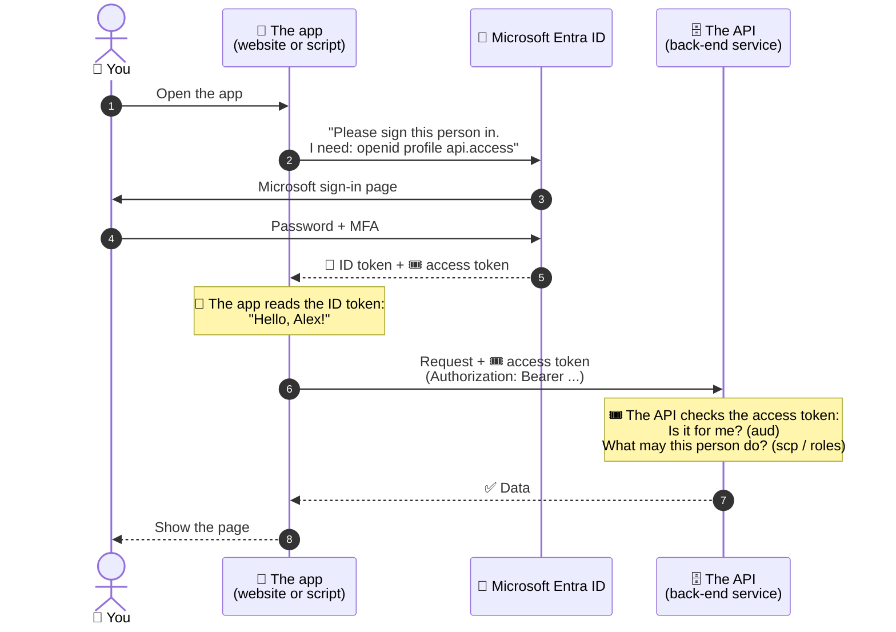
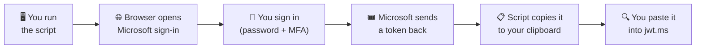
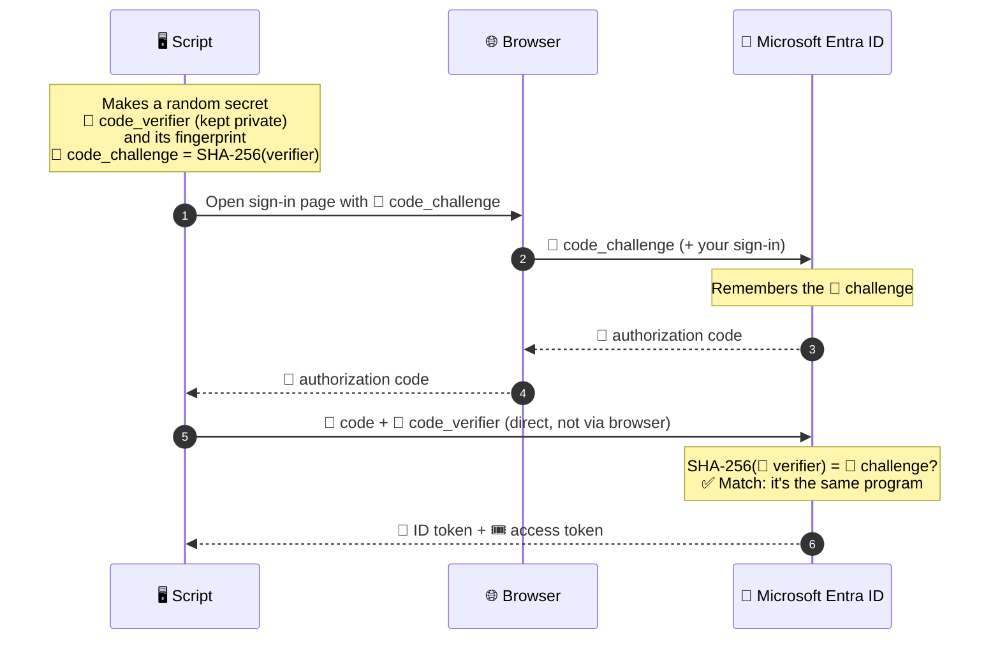

<a id="top"></a>

<div align="center">

# 🔑 Get-EntraToken

**See what Microsoft Entra ID says about you, in plain sight.**<br/>
Sign in with your normal Microsoft account page, get your token, and read it in your browser.

[](https://learn.microsoft.com/powershell/)
[](https://learn.microsoft.com/entra/identity-platform/)
[](#start)
[](https://github.com/21bshwjt/entra-id-claims-and-tokens/stargazers)

[What is a token?](#token) · [ID vs access token](#flow) · [PKCE](#pkce) · [Get started](#start) · [Read your token](#read) · [Problems?](#problems) · [Advanced guide](docs/Advanced-Guide.md)

</div>

---

## 📑 On this page

1. [🤔 What is this?](#what)
2. [🎟 First: what is a token?](#token)
3. [🔄 The token flow: ID token & access token](#flow)
4. [🧭 How the script works](#how)
5. [🔐 PKCE (Proof Key for Code Exchange)](#pkce)
6. [✅ What you need](#need)
7. [🚀 Get started in 4 steps](#start)
8. [🔍 Read your token](#read)
9. [⭐ Next level: a token for your own API](#next)
10. [🧯 Something went wrong?](#problems)
11. [🛡 Keep it safe](#safe)
12. [📖 Words you'll see](#words)
13. [🎓 Want to go deeper?](#deeper)

---

<a id="what"></a>

## 🤔 What is this?

A small PowerShell script. You run it, sign in with your Microsoft work account, and it hands you a **token**. You paste that token into [jwt.ms](https://jwt.ms) (a free Microsoft website) and see what's inside.

**Why would you want that?** When you connect an app to Microsoft Entra ID (for example ServiceNow, or an app your team builds), the app trusts what's written in the token. This script lets you **look before you hand it over**, so you know the app will get the right information.

---

<a id="token"></a>

## 🎟 First: what is a token?

Think of a **concert**:

| At a concert | In Entra ID |
| --- | --- |
| 🎫 You show your ID at the gate | You sign in with your password (and MFA) |
| 🪪 You get a **name badge** that says who you are | You get an **ID token**: *who you are* |
| 🎟 You get a **wristband** that opens one specific area | You get an **access token**: *what you may use* |
| The wristband says which area it's for | The token's **`aud`** says which app it's for |
| The wristband expires after the show | Tokens expire after about an hour |

Inside a token are small facts called **claims**, like `name: Alex` or `roles: Approver`. Apps read those claims to decide what you can see and do.

> [!NOTE]
> A token is just text. It looks like gibberish (`eyJ0eXAiOiJKV1Qi...`), but [jwt.ms](https://jwt.ms) turns it into readable lines. It's like opening an envelope.

---

<a id="flow"></a>

## 🔄 The token flow: ID token & access token

When you sign in to an app, **one sign-in gives you two different tokens**, and each one goes to a different place.



**In one sentence:** the **ID token stays with the app** (to know *who* you are), and the **access token is sent to the API** (to prove *what* you may do).

### 🪪 ID token vs 🎟 access token

| | 🪪 ID token | 🎟 access token |
| --- | --- | --- |
| **Concert comparison** | Name badge | Wristband for one area |
| **Answers the question** | *Who signed in?* | *What may they use?* |
| **Who reads it** | The app that signed you in | The API being called |
| **`aud` (addressed to)** | The app's client ID | The API |
| **Sent to other services?** | ❌ Never | ✅ Yes, in the `Authorization: Bearer` header |
| **Typical claims** | `name`, `preferred_username`, `oid` | `scp` (permissions), `roles`, `oid` |
| **You get it by asking for** | The `openid` scope | An API scope, e.g. `api://<client-id>/api.access` |
| **Lasts about** | 1 hour | 60 to 90 minutes |
| **With this script** | `-TokenType Id` | `-TokenType Access` (default) |

> [!WARNING]
> **Common mistake:** sending the ID token to an API. An API must only accept an **access token** whose `aud` is the API itself. An ID token only proves who signed in to the app.

<details>
<summary><b>🤔 Why does the scope matter so much?</b></summary>
<br/>

The **scope** is your shopping list when you sign in. Each word asks for something:

```text
openid   profile   api://<client-id>/api.access
  │         │              │
  │         │              └── 🎟 an access token for YOUR API
  │         └── 👤 your name and username in the ID token
  └── 🪪 an ID token
```

#### 🎟 One access token = one API

A wristband opens **one** area. An access token works the same way: it's made for **one** API only. The scope you ask for decides **which** API.

Let's compare two sign-ins with the same app:

| | Sign-in A | Sign-in B |
| --- | --- | --- |
| **Scope you ask for** | `api://<client-id>/api.access` | `User.Read` |
| **Which API that scope belongs to** | ✅ **Your app's API** | **Microsoft Graph** (Microsoft's API for Microsoft 365 data: your profile, mail, calendar) |
| **Token's `aud` (addressed to)** | Your client ID | Microsoft Graph |
| **Who will read the token** | Your API | Microsoft Graph |
| **Contains your app's roles** (e.g. `Expense.Approver`) | ✅ Yes | ❌ No |
| **Contains your custom claims** (e.g. `department`) | ✅ Yes | ❌ No |

**Why does B have no roles?** You set up roles and custom claims **on your app registration**. Entra ID only puts them in tokens **addressed to your app**. A token for Microsoft Graph is addressed to Graph, so Entra ID fills it with what **Graph** needs (like `scp: User.Read`), not your app's settings.

> [!TIP]
> **Testing your app's claims?** Use the script's default scope (`api://<client-id>/api.access`) and check that `aud` = your client ID. If `aud` is Microsoft Graph, you asked for the wrong scope. That's not a problem with your roles.

> [!NOTE]
> You can't get one token for two APIs. Asking for scopes from two different APIs in one request (for example `api://<client-id>/api.access User.Read`) fails with error `AADSTS700022`. An app that needs both asks for two tokens, one per API.

</details>

---

<a id="how"></a>

## 🧭 How the script works



That's all. You type your password **only on Microsoft's own page**; the script never sees it.

How can that be safe without an app password? The answer is **PKCE**, explained next.

---

<a id="pkce"></a>

## 🔐 PKCE (Proof Key for Code Exchange)

**PKCE** (say "pixie") is the security trick that lets this script get tokens **without any app password** (client secret).

### 😟 The problem it solves

Getting a token takes **two trips**:

1. 🌐 **Through your browser:** you sign in, and Microsoft sends back a short-lived **authorization code** (a voucher).
2. 🔒 **Direct from the script:** the script trades the voucher for the real tokens.

The voucher travels through the browser, where it could be seen or stolen (for example by a malicious program on the same computer). A desktop script can't safely hide a password, so how does Microsoft know the right program is cashing in the voucher?

### 🧥 The coat check comparison

| At a coat check | With PKCE |
| --- | --- |
| You make up a secret word and keep it to yourself | The script creates a random secret: the **code verifier** |
| You tell the attendant only a **scrambled version** of it | The script sends Microsoft only its fingerprint: the **code challenge** |
| You get a claim ticket | You sign in and get the **authorization code** |
| To collect the coat you need the ticket **and** the secret word | To get tokens the script sends the code **and** the verifier |
| The attendant scrambles your word the same way and compares | Entra ID hashes the verifier and compares it with the challenge |

A thief who grabs the ticket (the code) **still can't collect the coat**, because they never learned the secret word (the verifier). It never travelled through the browser.

### 🔄 Step by step



### 🧃 Why can't someone work out the secret from the fingerprint?

The fingerprint is made with **SHA-256**, a one-way scrambler. It's like a smoothie: easy to make from fruit, impossible to turn back into the fruit. Microsoft can check that the secret *matches* the fingerprint, but nobody can get the secret *from* the fingerprint.

### 🧑‍💻 Where it happens in the script

From [Scripts/Get-EntraToken.ps1](Scripts/Get-EntraToken.ps1):

```powershell
# 1. Make the secret (code verifier) from 32 random bytes
$rng = [System.Security.Cryptography.RandomNumberGenerator]::Create()
$buf = New-Object byte[] 32; $rng.GetBytes($buf)
$codeVerifier  = ConvertTo-Base64Url $buf

# 2. Make its fingerprint (code challenge) with SHA-256
$sha           = [System.Security.Cryptography.SHA256]::Create()
$codeChallenge = ConvertTo-Base64Url ($sha.ComputeHash([Text.Encoding]::ASCII.GetBytes($codeVerifier)))
```

| When | What the script sends | Name in the request |
| --- | --- | --- |
| Opening the sign-in page | 🧩 the fingerprint, and how it was made | `code_challenge=...` and `code_challenge_method=S256` |
| Trading the code for tokens | 🔑 the original secret | `code_verifier=...` |

> [!NOTE]
> The script also sends a random **`state`** value and checks that the same value comes back. That's a separate guard: it makes sure the sign-in response really belongs to the sign-in **you** started.

> [!TIP]
> PKCE isn't only for scripts. Microsoft recommends the authorization code flow with PKCE for desktop, mobile and single-page (browser) apps. Microsoft's libraries (MSAL) do all of this for you automatically.

---

<a id="need"></a>

## ✅ What you need

- [ ] A Windows computer with **PowerShell** (already built into Windows)
- [ ] A **Microsoft work or school account** in your organisation's Entra ID
- [ ] Permission to create or edit an **app registration** (ask your Entra admin if you're not sure; the *Application Administrator* role is enough)
- [ ] This repository downloaded (green **Code** button → **Download ZIP**, then unzip it)

---

<a id="start"></a>

## 🚀 Get started in 4 steps

### Step 1 · Create an app registration

An **app registration** is your app's ID card in Entra ID. Tokens are always issued *for* an app, so you need one.

1. Open the **[Microsoft Entra admin center](https://entra.microsoft.com)** and sign in.
2. Go to **Entra ID → App registrations → New registration**.
3. **Name:** `Token Test` (any name is fine).
4. **Supported account types:** *Accounts in this organizational directory only*.
5. Leave **Redirect URI** empty for now → click **Register**.
6. On the **Overview** page, copy these two values into Notepad:

| You'll see | You'll use it as |
| --- | --- |
| **Application (client) ID** | `-ClientId` |
| **Directory (tenant) ID** | `-TenantId` |

> [!TIP]
> These IDs aren't passwords, but they do identify your organisation. Don't post them publicly.

### Step 2 · Tell Entra where to send you back

After you sign in, Microsoft needs to know where to deliver the token. The script waits on your own computer (`localhost`).

1. In your app, open **Authentication → Add a platform**.
2. Choose **Mobile and desktop applications**.
3. In **Custom redirect URIs**, type: `http://localhost`
4. Click **Configure**.

> [!IMPORTANT]
> Pick **Mobile and desktop applications**, *not* "Single-page application" or "Web". The wrong choice is the most common cause of errors.

### Step 3 · Run the script

1. Open the unzipped folder, click the address bar, type `powershell` and press **Enter**. A PowerShell window opens in that folder.
2. Allow scripts for this window only (this doesn't change your computer's settings):

   ```powershell
   Set-ExecutionPolicy -Scope Process -ExecutionPolicy Bypass
   Unblock-File .\Scripts\Get-EntraToken.ps1
   ```

3. Run the script. Replace the two values with the IDs you copied in Step 1:

   ```powershell
   .\Scripts\Get-EntraToken.ps1 -TenantId "<your-tenant-id>" -ClientId "<your-client-id>" -Scope "openid profile" -TokenType Id
   ```

4. Your browser opens. **Sign in** like you normally do.
5. The browser says **"Signed in. You can close this tab."** ✅

### Step 4 · Look at your token

1. Back in PowerShell you'll see `=== Id token ===` and a long line of text. It's already copied for you.
2. Open **[jwt.ms](https://jwt.ms)** and paste it (**Ctrl + V**).
3. Click the **Claims** tab. 🎉 You're reading what Entra ID says about you.

---

<a id="read"></a>

## 🔍 Read your token

These are the claims you'll see in your first ID token, in plain words:

| Claim | What it means | Example |
| --- | --- | --- |
| `name` | Your display name | `Alex Smith` |
| `preferred_username` | The account you signed in with | `alex@contoso.com` |
| `oid` | Your permanent user ID. Never changes, even if your name or email does | `a1b2c3d4-...` |
| `tid` | Your organisation's ID (the tenant ID you used) | `ffff0000-...` |
| `aud` | **Who this token is for.** In an ID token, it's your app's client ID | your `-ClientId` |
| `iss` | Who created the token (Microsoft Entra ID, for your tenant) | `https://login.microsoftonline.com/<tenant-id>/v2.0` |
| `exp` | When it stops working (jwt.ms shows the time when you hover over it) | about 1 hour from now |

> [!TIP]
> **Golden rule:** always check **`aud`** first. If a token isn't addressed to the right app, nothing else in it matters, just like a wristband for the wrong area.

You can ignore claims like `aio`, `rh`, `uti` and `sid`. They're for Microsoft's own bookkeeping.

---

<a id="next"></a>

## ⭐ Next level: a token for your own API

Step 3 got you an **ID token** (the name badge). Real apps usually need an **access token** (the wristband) for an **API**, meaning the back-end service the app talks to. Here's how to get one for your app.

<details>
<summary><b>Show the steps</b></summary>
<br/>

In your app registration:

1. **Expose an API → Application ID URI → Add** → keep `api://<client-id>` → **Save**.
2. **Add a scope** → Scope name `api.access`, *Who can consent:* Admins only, State: Enabled → **Add scope**.
3. **Manifest** → find the `"api"` section → set `"requestedAccessTokenVersion": 2` → **Save**.
   *(This gives you the modern v2.0 token format.)*
4. **API permissions → Add a permission → APIs my organization uses →** your app **→ Delegated → `api.access`** → **Add**, then **Grant admin consent**.

Now run the script **without** `-Scope` and `-TokenType`. It asks for an access token for your API by default:

```powershell
.\Scripts\Get-EntraToken.ps1 -TenantId "<your-tenant-id>" -ClientId "<your-client-id>"
```

In jwt.ms, check:

| Claim | You should see |
| --- | --- |
| `aud` | Your client ID: the token is for *your* API ✅ |
| `scp` | `api.access`: the permission you created |
| `ver` | `2.0` |

**Want roles, groups or custom details (like department) in the token?** The [Advanced guide](docs/Advanced-Guide.md#use-cases) has 10 step-by-step examples.

</details>

---

<a id="problems"></a>

## 🧯 Something went wrong?

Errors from Microsoft start with **AADSTS** and a number. Find yours:

| What you see | What it means | How to fix it |
| --- | --- | --- |
| `AADSTS50011` | Entra doesn't know where to send you back | Do [Step 2](#start) again: `http://localhost` under **Mobile and desktop applications** |
| `AADSTS9002327` | The redirect was added as **Single-page application** | Remove it there, add it under **Mobile and desktop applications** |
| `AADSTS700016` | Entra can't find your app | Check `-TenantId` and `-ClientId` for typos |
| `AADSTS50105` | Your app only lets assigned people in, and you're not assigned | **Enterprise apps → your app → Users and groups → Add user/group** |
| `AADSTS65001` | Nobody has approved (consented to) the permission | **API permissions → Grant admin consent** |
| `AADSTS500011` | You asked for your API, but it isn't set up yet | Do the [Next level](#next) steps, or use `-Scope "openid profile" -TokenType Id` |
| "running scripts is disabled" | PowerShell is blocking the script | Run the two commands in [Step 3](#start) first |
| "Could not listen on ..." | Another program is using the port | Add `-Port 8500` to the command |

More errors and fixes: [Advanced guide → Troubleshooting](docs/Advanced-Guide.md#troubleshooting).

---

<a id="safe"></a>

## 🛡 Keep it safe

> [!CAUTION]
> A token works like a **key**: anyone who has it can use it until it expires. Treat it like a password.

- 🙅 Don't share tokens in chat, email or screenshots, and never commit them to GitHub.
- 📋 The token stays on your clipboard. Copy something else when you're done.
- 🧹 When you're finished testing, remove `http://localhost` from your app's **Authentication** page.
- 🔑 The script never sees your password. You only type it on Microsoft's own page.

---

<a id="words"></a>

## 📖 Words you'll see

| Word | Plain meaning |
| --- | --- |
| **Microsoft Entra ID** | Microsoft's sign-in service for work accounts (formerly *Azure AD*) |
| **Tenant** | Your organisation's own space in Entra ID |
| **App registration** | Your app's ID card in Entra ID |
| **Client ID** | The app's unique number |
| **Token** | A signed digital pass that an app trusts |
| **Claim** | One fact inside a token, like your name or role |
| **ID token** | The name badge: *who you are* |
| **Access token** | The wristband: *what you're allowed to use*, for one specific API |
| **API** | A back-end service an app calls to get or save data |
| **Scope** | What you're asking for when you sign in; it decides which API the access token is for |
| **`aud` (audience)** | Which app the token is addressed to |
| **Consent** | Approving that an app may use a permission |
| **Redirect URI** | Where Microsoft sends you back after sign-in |
| **MFA** | Multi-factor authentication: a second check, like a code on your phone |
| **Authorization code** | A short-lived voucher Microsoft gives after sign-in, traded for tokens |
| **PKCE** | A secret plus its fingerprint that proves the program trading the voucher is the one that started the sign-in |
| **Code verifier / code challenge** | The PKCE secret, and its SHA-256 fingerprint |

---

<a id="deeper"></a>

## 🎓 Want to go deeper?

The **[Advanced guide](docs/Advanced-Guide.md)** covers:

- 🔍 A full claim-by-claim checklist for jwt.ms
- 🧯 A complete error table
- 🧩 [10 real-world use cases](docs/Advanced-Guide.md#use-cases) (roles, admin pages, groups, custom claims, apps with no user, Microsoft Graph, MFA for sensitive actions, guests and more)
- 🧱 The three kinds of app, and how the Azure portal sign-in differs from your own app
- 📚 Links to the Microsoft Learn pages everything was checked against

<details>
<summary><b>⚙ All script options</b></summary>
<br/>

| Option | Required | Default | What it does |
| --- | :---: | --- | --- |
| `-TenantId` | ✅ | | Your organisation's ID (**Entra ID → Overview**) |
| `-ClientId` | ✅ | | Your app's ID (**App registrations → your app → Overview**) |
| `-Scope` | | `openid profile api://<ClientId>/api.access` | What to ask for. Decides which API the access token is for |
| `-TokenType` | | `Access` | `Access` (wristband) or `Id` (name badge) |
| `-Port` | | `8400` | The local port the script listens on |

</details>

<details>
<summary><b>📁 What's in this repository</b></summary>
<br/>

```text
📦 entra-id-claims-and-tokens
 ┣ 📂 Scripts
 ┃ ┗ 📜 Get-EntraToken.ps1   # The script
 ┣ 📂 docs
 ┃ ┗ 📜 Advanced-Guide.md    # Detailed reference and 10 use cases
 ┗ 📜 README.md              # This beginner guide
```

</details>

<details>
<summary><b>📝 Changelog</b></summary>
<br/>

| Version | Date | Change |
| --- | --- | --- |
| 1.0 | 2026-11-22 | First version: browser sign-in (Authorization Code + PKCE), `-TokenType`, `-Scope`, `-Port`, copy to clipboard |
| 1.1 | 2026-11-22 | Added 10 claim use cases, the three kinds of app, and portal vs own app |
| 1.2 | 2026-11-22 | Moved the script to `Scripts/`; facts checked against Microsoft Learn |
| 1.3 | 2026-11-22 | Beginner-friendly README; detailed content moved to `docs/Advanced-Guide.md` |

</details>

---

<div align="center">

**Built with ❤ using PowerShell and Microsoft Entra ID**

⭐ If this helped you understand tokens, give the repo a star!

[⬆ Back to top](#top)

</div>
