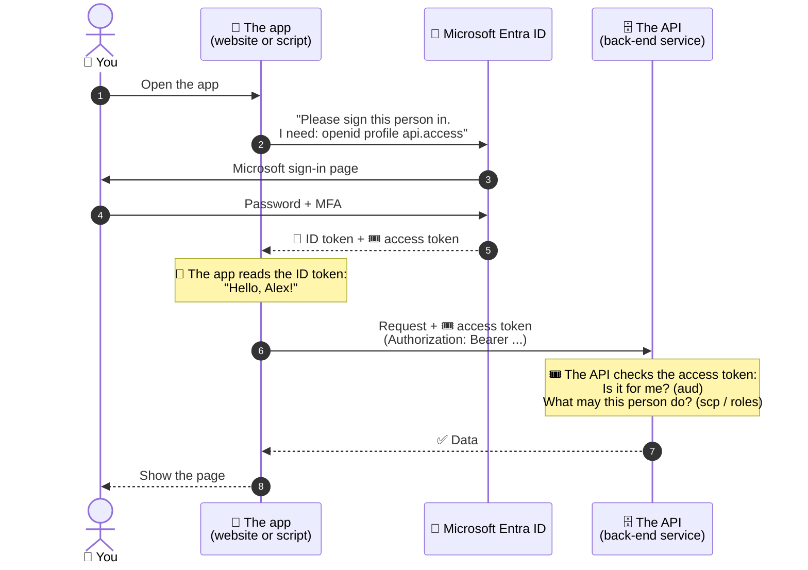
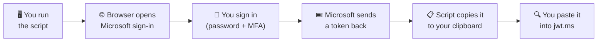
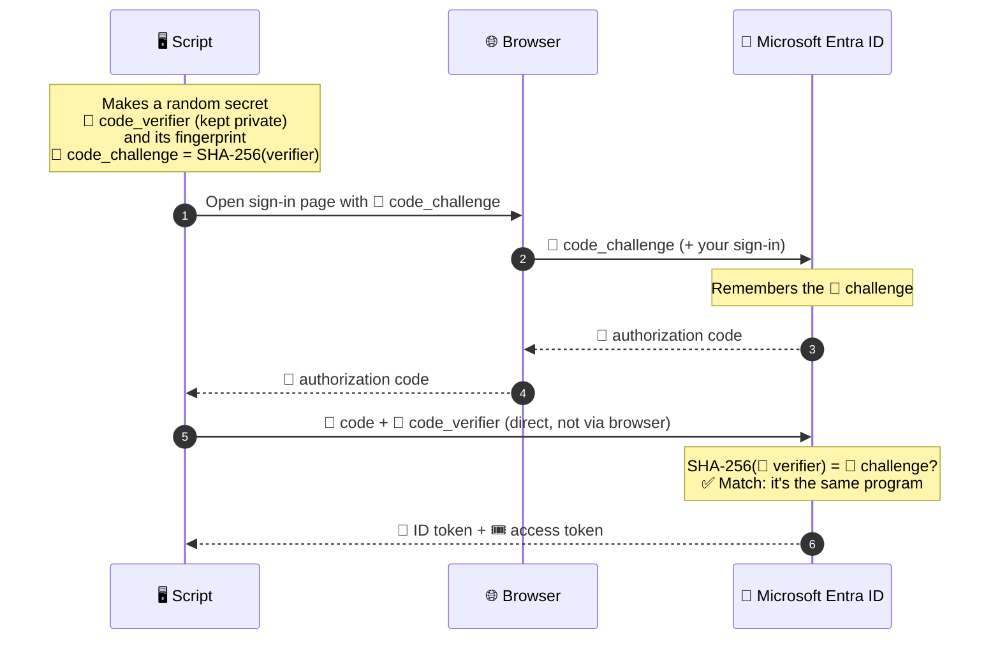
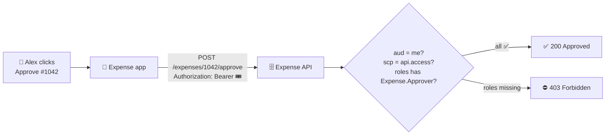
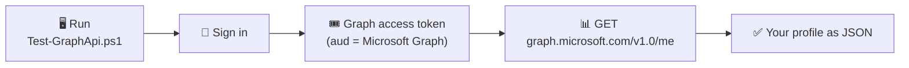

<a id="top"></a>

<div align="center">

# 🔑 Get-EntraToken

**See what Microsoft Entra ID says about you, in plain sight.**<br/>
Sign in with your normal Microsoft account page, get your token, and read it in your browser.

[](https://learn.microsoft.com/powershell/)
[](https://learn.microsoft.com/entra/identity-platform/)
[](#start)
[](https://github.com/21bshwjt/entra-id-claims-and-tokens/stargazers)

[What is a token?](#token) · [ID vs access token](#flow) · [PKCE](#pkce) · [Get started](#start) · [Graph test](#graph) · [Read your token](#read) · [Problems?](#problems) · [Advanced guide](docs/Advanced-Guide.md)

</div>

---

## 📑 On this page

1. [🤔 What is this?](#what)
2. [🎟 First: what is a token?](#token)
3. [🔄 The token flow: ID token & access token](#flow)
4. [🧭 How the script works](#how)
5. [🔐 PKCE (Proof Key for Code Exchange)](#pkce)
6. [✅ What you need](#need)
7. [🚀 Get started in 4 steps](#start)
8. [🔍 Read your token](#read)
9. [⭐ Next level: a token for your own API](#next)
10. [📊 Test with Microsoft Graph](#graph)
11. [🧯 Something went wrong?](#problems)
12. [🛡 Keep it safe](#safe)
13. [📖 Words you'll see](#words)
14. [📒 Research notes](#research)
15. [🎓 Want to go deeper?](#deeper)

---

<a id="what"></a>

## 🤔 What is this?

A small PowerShell script. You run it, sign in with your Microsoft work account, and it hands you a **token**. You paste that token into [jwt.ms](https://jwt.ms) (a free Microsoft website) and see what's inside.

**Why would you want that?** When you connect an app to Microsoft Entra ID (for example ServiceNow, or an app your team builds), the app trusts what's written in the token. This script lets you **look before you hand it over**, so you know the app will get the right information.

---

<a id="token"></a>

## 🎟 First: what is a token?

Think of a **concert**:

| At a concert | In Entra ID |
| --- | --- |
| 🎫 You show your ID at the gate | You sign in with your password (and MFA) |
| 🪪 You get a **name badge** that says who you are | You get an **ID token**: *who you are* |
| 🎟 You get a **wristband** that opens one specific area | You get an **access token**: *what you may use* |
| The wristband says which area it's for | The token's **`aud`** says which app it's for |
| The wristband expires after the show | Tokens expire after about an hour |

Inside a token are small facts called **claims**, like `name: Alex` or `roles: Approver`. Apps read those claims to decide what you can see and do.

> [!NOTE]
> A token is just text. It looks like gibberish (`eyJ0eXAiOiJKV1Qi...`), but [jwt.ms](https://jwt.ms) turns it into readable lines. It's like opening an envelope.

---

<a id="flow"></a>

## 🔄 The token flow: ID token & access token

When you sign in to an app, **one sign-in gives you two different tokens**, and each one goes to a different place.



**In one sentence:** the **ID token stays with the app** (to know *who* you are), and the **access token is sent to the API** (to prove *what* you may do).

### 🪪 ID token vs 🎟 access token

| | 🪪 ID token | 🎟 access token |
| --- | --- | --- |
| **Concert comparison** | Name badge | Wristband for one area |
| **Answers the question** | *Who signed in?* | *What may they use?* |
| **Who reads it** | The app that signed you in | The API being called |
| **`aud` (addressed to)** | The app's client ID | The API |
| **Sent to other services?** | ❌ Never | ✅ Yes, in the `Authorization: Bearer` header |
| **Typical claims** | `name`, `preferred_username`, `oid` | `scp` (permissions), `roles`, `oid` |
| **You get it by asking for** | The `openid` scope | An API scope, e.g. `api://<client-id>/api.access` |
| **Lasts about** | 1 hour | 60 to 90 minutes |
| **With this script** | `-TokenType Id` | `-TokenType Access` (default) |

> [!WARNING]
> **Common mistake:** sending the ID token to an API. An API must only accept an **access token** whose `aud` is the API itself. An ID token only proves who signed in to the app.

<details>
<summary><b>🤔 Why does the scope matter so much?</b></summary>
<br/>

The **scope** is your shopping list when you sign in. Each word asks for something:

```text
openid   profile   api://<client-id>/api.access
  │         │              │
  │         │              └── 🎟 an access token for YOUR API
  │         └── 👤 your name and username in the ID token
  └── 🪪 an ID token
```

#### 🎟 One access token = one API

A wristband opens **one** area. An access token works the same way: it's made for **one** API only. The scope you ask for decides **which** API.

Let's compare two sign-ins with the same app:

| | Sign-in A | Sign-in B |
| --- | --- | --- |
| **Scope you ask for** | `api://<client-id>/api.access` | `User.Read` |
| **Which API that scope belongs to** | ✅ **Your app's API** | **Microsoft Graph** (Microsoft's API for Microsoft 365 data: your profile, mail, calendar) |
| **Token's `aud` (addressed to)** | Your client ID | Microsoft Graph |
| **Who will read the token** | Your API | Microsoft Graph |
| **Contains your app's roles** (e.g. `Expense.Approver`) | ✅ Yes | ❌ No |
| **Contains your custom claims** (e.g. `department`) | ✅ Yes | ❌ No |

**Why does B have no roles?** You set up roles and custom claims **on your app registration**. Entra ID only puts them in tokens **addressed to your app**. A token for Microsoft Graph is addressed to Graph, so Entra ID fills it with what **Graph** needs (like `scp: User.Read`), not your app's settings.

> [!TIP]
> **Testing your app's claims?** Use the script's default scope (`api://<client-id>/api.access`) and check that `aud` = your client ID. If `aud` is Microsoft Graph, you asked for the wrong scope. That's not a problem with your roles.

> [!NOTE]
> You can't get one token for two APIs. Asking for scopes from two different APIs in one request (for example `api://<client-id>/api.access User.Read`) fails with error `AADSTS700022`. An app that needs both asks for two tokens, one per API.

</details>

---

<a id="how"></a>

## 🧭 How the script works



That's all. You type your password **only on Microsoft's own page**; the script never sees it.

How can that be safe without an app password? The answer is **PKCE**, explained next.

---

<a id="pkce"></a>

## 🔐 PKCE (Proof Key for Code Exchange)

**PKCE** (say "pixie") is the security trick that lets this script get tokens **without any app password** (client secret).

### 😟 The problem it solves

Getting a token takes **two trips**:

1. 🌐 **Through your browser:** you sign in, and Microsoft sends back a short-lived **authorization code** (a voucher).
2. 🔒 **Direct from the script:** the script trades the voucher for the real tokens.

The voucher travels through the browser, where it could be seen or stolen (for example by a malicious program on the same computer). A desktop script can't safely hide a password, so how does Microsoft know the right program is cashing in the voucher?

### 🧥 The coat check comparison

| At a coat check | With PKCE |
| --- | --- |
| You make up a secret word and keep it to yourself | The script creates a random secret: the **code verifier** |
| You tell the attendant only a **scrambled version** of it | The script sends Microsoft only its fingerprint: the **code challenge** |
| You get a claim ticket | You sign in and get the **authorization code** |
| To collect the coat you need the ticket **and** the secret word | To get tokens the script sends the code **and** the verifier |
| The attendant scrambles your word the same way and compares | Entra ID hashes the verifier and compares it with the challenge |

A thief who grabs the ticket (the code) **still can't collect the coat**, because they never learned the secret word (the verifier). It never travelled through the browser.

### 🔄 Step by step



### 🧃 Why can't someone work out the secret from the fingerprint?

The fingerprint is made with **SHA-256**, a one-way scrambler. It's like a smoothie: easy to make from fruit, impossible to turn back into the fruit. Microsoft can check that the secret *matches* the fingerprint, but nobody can get the secret *from* the fingerprint.

### 🧑‍💻 Where it happens in the script

From [Scripts/Get-EntraToken.ps1](Scripts/Get-EntraToken.ps1):

```powershell
# 1. Make the secret (code verifier) from 32 random bytes
$rng = [System.Security.Cryptography.RandomNumberGenerator]::Create()
$buf = New-Object byte[] 32; $rng.GetBytes($buf)
$codeVerifier  = ConvertTo-Base64Url $buf

# 2. Make its fingerprint (code challenge) with SHA-256
$sha           = [System.Security.Cryptography.SHA256]::Create()
$codeChallenge = ConvertTo-Base64Url ($sha.ComputeHash([Text.Encoding]::ASCII.GetBytes($codeVerifier)))
```

| When | What the script sends | Name in the request |
| --- | --- | --- |
| Opening the sign-in page | 🧩 the fingerprint, and how it was made | `code_challenge=...` and `code_challenge_method=S256` |
| Trading the code for tokens | 🔑 the original secret | `code_verifier=...` |

> [!NOTE]
> The script also sends a random **`state`** value and checks that the same value comes back. That's a separate guard: it makes sure the sign-in response really belongs to the sign-in **you** started.

> [!TIP]
> PKCE isn't only for scripts. Microsoft recommends the authorization code flow with PKCE for desktop, mobile and single-page (browser) apps. Microsoft's libraries (MSAL) do all of this for you automatically.

---

<a id="need"></a>

## ✅ What you need

- [ ] A Windows computer with **PowerShell** (already built into Windows)
- [ ] A **Microsoft work or school account** in your organisation's Entra ID
- [ ] Permission to create or edit an **app registration** (ask your Entra admin if you're not sure; the *Application Administrator* role is enough)
- [ ] This repository downloaded (green **Code** button → **Download ZIP**, then unzip it)

---

<a id="start"></a>

## 🚀 Get started in 4 steps

### Step 1 · Create an app registration

An **app registration** is your app's ID card in Entra ID. Tokens are always issued *for* an app, so you need one.

1. Open the **[Microsoft Entra admin center](https://entra.microsoft.com)** and sign in.
2. Go to **Entra ID → App registrations → New registration**.
3. **Name:** `Token Test` (any name is fine).
4. **Supported account types:** *Accounts in this organizational directory only*.
5. Leave **Redirect URI** empty for now → click **Register**.
6. On the **Overview** page, copy these two values into Notepad:

| You'll see | You'll use it as |
| --- | --- |
| **Application (client) ID** | `-ClientId` |
| **Directory (tenant) ID** | `-TenantId` |

> [!TIP]
> These IDs aren't passwords, but they do identify your organisation. Don't post them publicly.

### Step 2 · Tell Entra where to send you back

After you sign in, Microsoft needs to know where to deliver the token. The script waits on your own computer (`localhost`).

1. In your app, open **Authentication → Add a platform**.
2. Choose **Mobile and desktop applications**.
3. In **Custom redirect URIs**, type: `http://localhost`
4. Click **Configure**.

> [!IMPORTANT]
> Pick **Mobile and desktop applications**, *not* "Single-page application" or "Web". The wrong choice is the most common cause of errors.

> [!NOTE]
> **No port needed.** The script listens on `http://localhost:8400/` by default, but you register just `http://localhost`. For `localhost` addresses, Entra ID ignores the port when it checks the redirect, so any `-Port` works with this one entry.

### Step 3 · Run the script

1. Open the unzipped folder, click the address bar, type `powershell` and press **Enter**. A PowerShell window opens in that folder.
2. Allow scripts for this window only (this doesn't change your computer's settings):

   ```powershell
   Set-ExecutionPolicy -Scope Process -ExecutionPolicy Bypass
   Unblock-File .\Scripts\Get-EntraToken.ps1
   ```

3. Run the script. Replace the two values with the IDs you copied in Step 1:

   ```powershell
   .\Scripts\Get-EntraToken.ps1 -TenantId "<your-tenant-id>" -ClientId "<your-client-id>" -Scope "openid profile" -TokenType Id
   ```

4. Your browser opens. **Sign in** like you normally do.
5. The browser says **"Signed in. You can close this tab."** ✅

### Step 4 · Look at your token

1. Back in PowerShell you'll see `=== Id token ===`, a long line of text (already copied for you), and a **claim check** like this:

   ```text
   === Claim check: Id token ===
   [OK]   aud (for)           : <your-client-id>
   [OK]   ver                 : 2.0
   [INFO] name                : Alex Smith
   [INFO] user                : alex@contoso.com
   ```
2. Open **[jwt.ms](https://jwt.ms)** and paste it (**Ctrl + V**).
3. Click the **Claims** tab. 🎉 You're reading what Entra ID says about you.

---

<a id="read"></a>

## 🔍 Read your token

These are the claims you'll see in your first ID token, in plain words:

| Claim | What it means | Example |
| --- | --- | --- |
| `name` | Your display name | `Alex Smith` |
| `preferred_username` | The account you signed in with | `alex@contoso.com` |
| `oid` | Your permanent user ID. Never changes, even if your name or email does | `a1b2c3d4-...` |
| `tid` | Your organisation's ID (the tenant ID you used) | `ffff0000-...` |
| `aud` | **Who this token is for.** In an ID token, it's your app's client ID | your `-ClientId` |
| `iss` | Who created the token (Microsoft Entra ID, for your tenant) | `https://login.microsoftonline.com/<tenant-id>/v2.0` |
| `exp` | When it stops working (jwt.ms shows the time when you hover over it) | about 1 hour from now |

> [!TIP]
> **Golden rule:** always check **`aud`** first. If a token isn't addressed to the right app, nothing else in it matters, just like a wristband for the wrong area.

You can ignore claims like `aio`, `rh`, `uti` and `sid`. They're for Microsoft's own bookkeeping.

### 🪪 or 🎟? Telling the two tokens apart in jwt.ms

Both are JWTs and look the same (`eyJ...`). The claims tell you which is which.

> [!TIP]
> **Quick rule:** look for **`scp`**. If it's there, it's an 🎟 **access token**. If there's no `scp` and `aud` is your app's client ID, it's an 🪪 **ID token**.

| Check in jwt.ms | 🪪 ID token | 🎟 Access token |
| --- | --- | --- |
| **`scp`** (permissions) | ❌ Never | ✅ Yes, e.g. `api.access` or `User.Read` |
| **`aud`** (addressed to) | Always **your app's** client ID | The **API**: your client ID (your own API) or Microsoft Graph |
| **`azp`** / **`azpacr`** | ❌ Not there | ✅ In v2.0 access tokens: the calling app, and how it proved itself |
| `name`, `preferred_username`, `oid` | ✅ Yes (with `profile`) | Often present too, so not a reliable test |
| `roles`, custom claims | ✅ If assigned or configured | ✅ If the token is for your app |

**Tricky case:** with the default scope `api://<client-id>/api.access`, your app is both the client **and** the API, so **both tokens have the same `aud`**. Use `scp` (and `azp`) to tell them apart:

```text
🪪 ID token                          🎟 Access token (your API)
"aud": "<your-client-id>"            "aud": "<your-client-id>"
"name": "Alex Smith"                 "scp": "api.access"        ← the giveaway
"preferred_username": "alex@..."     "azp": "<your-client-id>"
"oid": "..."                         "azpacr": "0"
```

The scripts label them for you too: the claim check says `Access token` or `Id token`, and `-ShowJwt` prints `ACCESS TOKEN` and `ID TOKEN` headings.

---

<a id="next"></a>

## ⭐ Next level: a token for your own API

Step 3 got you an **ID token** (the name badge). Real apps usually need an **access token** (the wristband) for an **API**, meaning the back-end service the app talks to. Here's how to get one for your app.

<details>
<summary><b>Show the steps</b></summary>
<br/>

In your app registration:

1. **Expose an API → Application ID URI → Add** → keep `api://<client-id>` → **Save**.
2. **Add a scope** → Scope name `api.access`, *Who can consent:* Admins only, State: Enabled → **Add scope**.
3. **Manifest** → find the `"api"` section → set `"requestedAccessTokenVersion": 2` → **Save**.
   *(This gives you the modern v2.0 token format.)*
4. **API permissions → Add a permission → APIs my organization uses →** your app **→ Delegated → `api.access`** → **Add**, then **Grant admin consent**.

Now run the script **without** `-Scope` and `-TokenType`. It asks for an access token for your API by default:

```powershell
.\Scripts\Get-EntraToken.ps1 -TenantId "<your-tenant-id>" -ClientId "<your-client-id>"
```

In jwt.ms, check:

| Claim | You should see |
| --- | --- |
| `aud` | Your client ID: the token is for *your* API ✅ |
| `scp` | `api.access`: the permission you created |
| `ver` | `2.0` |

**Want roles, groups or custom details (like department) in the token?** The [Advanced guide](docs/Advanced-Guide.md#use-cases) has 10 step-by-step examples.

</details>

### 🧾 Real example: approving an expense

<details>
<summary><b>Show the example</b></summary>
<br/>

**The story:** Contoso has an **Expense app** (the website) and an **Expense API** (the back-end). Alex is a manager and clicks **Approve** on expense #1042. The website sends Alex's access token to the API, and the API must answer three questions before it approves anything:

1. Is this token **for me**? → `aud`
2. Did the website get **permission to call me** on Alex's behalf? → `scp`
3. Is Alex allowed to **approve**? → `roles`



#### 1 · Set it up (one app registration plays both parts)

| | Where | What |
| --- | --- | --- |
| a | Steps 1 to 4 above | `api://<client-id>/api.access` scope, v2.0 tokens, admin consent |
| b | **App roles → Create app role** | Display name `Expense Approver` · Members **Users/Groups** · Value `Expense.Approver` → **Apply** |
| c | **Enterprise apps →** your app **→ Users and groups → Add user/group** | Alex (or the *Managers* group) → role **Expense Approver** → **Assign** |

*(Step b and c are [Use case 1 in the Advanced guide](docs/Advanced-Guide.md#use-cases), with more detail.)*

#### 2 · Get Alex's token

Sign in as Alex and run the script with no `-Scope`:

```powershell
.\Scripts\Get-EntraToken.ps1 -TenantId "<your-tenant-id>" -ClientId "<your-client-id>"
```

The claim check answers all three questions for you:

```text
=== Claim check: Access token ===
[OK]   aud (for)           : 6e74172b-be56-4843-9ff4-e66a39bb12e3
[OK]   ver                 : 2.0
[INFO] iss (issuer)        : https://login.microsoftonline.com/aaaabbbb-0000-cccc-1111-dddd2222eeee/v2.0
[INFO] name                : Alex Smith
[INFO] user                : alex@contoso.com
[INFO] oid (user ID)       : 00aa00aa-bb11-cc22-dd33-44ee44ee44ee
[OK]   scp (permissions)   : api.access
[INFO] azpacr (client)     : 0 = public client (PKCE)
[OK]   roles               : Expense.Approver
```

And in jwt.ms the important claims look like this (made-up IDs):

```json
{
  "aud": "6e74172b-be56-4843-9ff4-e66a39bb12e3",
  "iss": "https://login.microsoftonline.com/aaaabbbb-0000-cccc-1111-dddd2222eeee/v2.0",
  "exp": 1795430400,
  "azp": "6e74172b-be56-4843-9ff4-e66a39bb12e3",
  "azpacr": "0",
  "name": "Alex Smith",
  "preferred_username": "alex@contoso.com",
  "oid": "00aa00aa-bb11-cc22-dd33-44ee44ee44ee",
  "scp": "api.access",
  "roles": ["Expense.Approver"],
  "ver": "2.0"
}
```

#### 3 · What the API decides

| The API asks | Claim | Alex's token | Result |
| --- | --- | --- | --- |
| Is it signed by Entra ID and not expired? | signature, `iss`, `exp` | ✅ valid | continue |
| Is it for me? | `aud` | ✅ my client ID | continue |
| May this app call me for the user? | `scp` | ✅ `api.access` | continue |
| May this person approve? | `roles` | ✅ `Expense.Approver` | **200 Approved** |
| Who approved it (for the audit log)? | `oid` | `00aa00aa-...` | saved with the expense |

Now sign in as **Sam**, who isn't a manager. Sam's token has the same `aud` and `scp`, but the claim check shows `roles : (none)`. The API stops at the last question and returns **403 Forbidden**. Same app, same API, the token makes the difference.

> [!TIP]
> Store **`oid`** in the audit log, not `name` or `preferred_username`. Names and emails can change, `oid` never does.

#### 4 · Send it like the app would

The token is on your clipboard, so you can call the API exactly the way the website does (use your own API's address):

```powershell
$token = Get-Clipboard
Invoke-RestMethod -Method Post -Uri "https://<your-expense-api>/expenses/1042/approve" `
    -Headers @{ Authorization = "Bearer $token" }
```

> [!IMPORTANT]
> A real API never trusts the claims until it has **checked the signature** against Entra ID's public keys. Don't write that yourself: use Microsoft's libraries, for example [Microsoft.Identity.Web](https://learn.microsoft.com/entra/identity-platform/scenario-protected-web-api-overview) for ASP.NET Core. They check the signature, `iss`, `aud` and `exp`, and give your code the `scp` and `roles` to check.

</details>

---

<a id="graph"></a>

## 📊 Test with Microsoft Graph

**Microsoft Graph** is Microsoft's API for Microsoft 365 data: your profile, mail, calendar, Teams and more. The second script, [Scripts/Test-GraphApi.ps1](Scripts/Test-GraphApi.ps1), signs you in the same way (browser + PKCE, no secret), gets a **Graph access token**, and **uses it** to call Graph for you.



### Step 1 · Check the app's Graph permissions

In your app registration: **API permissions**. New apps already have **Microsoft Graph → User.Read**, which is all you need for `/me`.

For other data, **Add a permission → Microsoft Graph → Delegated permissions**, then add what you need:

| To call | What it returns | Permission needed (least privilege) |
| --- | --- | --- |
| `/me` | Your profile | `User.Read` |
| `/me/memberOf` | Groups and roles you're a direct member of | `User.Read` |
| `/me/events` | Your calendar events | `Calendars.ReadBasic` |
| `/me/messages` | Your emails (without the body) | `Mail.ReadBasic` |

> [!NOTE]
> Delegated permissions like these let the app act **as you**, so it can only see what **you** can see. If your organisation doesn't let users approve permissions themselves, an admin must click **Grant admin consent**.

### Step 2 · Run it

```powershell
# Your profile (the simplest test)
.\Scripts\Test-GraphApi.ps1 -TenantId "<your-tenant-id>" -ClientId "<your-client-id>"

# Your profile and your groups
.\Scripts\Test-GraphApi.ps1 -TenantId "<your-tenant-id>" -ClientId "<your-client-id>" -Endpoint '/me', '/me/memberOf'

# Your profile, plus the complete JWT (header, all claims, times, signature)
.\Scripts\Test-GraphApi.ps1 -TenantId "<your-tenant-id>" -ClientId "<your-client-id>" -ShowJwt

# Your next 5 calendar events (ask for the extra permission with -Scope)
.\Scripts\Test-GraphApi.ps1 -TenantId "<your-tenant-id>" -ClientId "<your-client-id>" `
    -Scope "openid profile User.Read Calendars.ReadBasic" `
    -Endpoint '/me/events?$top=5&$select=subject,start,end'
```

> [!IMPORTANT]
> Put endpoints in **single quotes** (`'...'`). In double quotes PowerShell treats `$top` and `$select` as variables and removes them.

### Step 3 · Read the result

The script prints three things:

1. **What the token allows:** the granted permissions (e.g. `User.Read`), when it expires, and its `aud` (Microsoft Graph).

   > [!NOTE]
   > This Graph token **won't** contain your app's roles or custom claims, because it's made for Graph. Add `-ShowJwt` and look at the **ID TOKEN** section to see them. See [Research notes → Graph facts](#research).

2. **The call:** `=== GET https://graph.microsoft.com/v1.0/me ===`
3. **Graph's answer** as JSON, for example `displayName`, `mail`, `jobTitle`. For lists it also says how many items came back.

If a call fails, the script shows Graph's error and a hint:

| Result | Meaning | Fix |
| --- | --- | --- |
| **HTTP 403** | The token doesn't have the permission this endpoint needs | Add the permission in **API permissions** *and* in `-Scope`, then consent |
| **HTTP 404** | Nothing found at that path (e.g. a user with no mailbox) | Check the path; try `/me` first |
| **HTTP 401** | The token was rejected or expired | Run the script again |
| **My roles / custom claims aren't in the token** | Expected: the Graph access token is for Graph, not your app | With `-ShowJwt`, look in the **ID TOKEN** section, or use `Get-EntraToken.ps1` for a token for your own API |

<details>
<summary><b>⚙ All Test-GraphApi.ps1 options</b></summary>
<br/>

| Option | Required | Default | What it does |
| --- | :---: | --- | --- |
| `-TenantId` | ✅ | | Your organisation's ID |
| `-ClientId` | ✅ | | Your app's ID |
| `-Scope` | | `openid profile User.Read` | Graph permissions to ask for. Graph scopes only; mixing in your own API's scope fails with `AADSTS700022` |
| `-Endpoint` | | `/me` | One or more Graph paths to call (or full `https://graph.microsoft.com/...` URLs) |
| `-ApiVersion` | | `v1.0` | `v1.0` or `beta` (beta can change; don't rely on it in production) |
| `-Port` | | `8400` | The local port the script listens on |
| `-ShowJwt` | | off | Print the **complete JWT** for the access token and the ID token: raw token, decoded header, every claim, readable times (`iat`, `nbf`, `exp`) and the signature. Copies the access token for jwt.ms. Alias: `-ShowToken` |

</details>

> [!TIP]
> Want to explore more endpoints? Try them first in **[Graph Explorer](https://developer.microsoft.com/graph/graph-explorer)**, Microsoft's free web tool. Each API page on Microsoft Learn lists the permission it needs.

---

<a id="problems"></a>

## 🧯 Something went wrong?

Errors from Microsoft start with **AADSTS** and a number. Find yours:

| What you see | What it means | How to fix it |
| --- | --- | --- |
| `AADSTS50011` | Entra doesn't know where to send you back | Do [Step 2](#start) again: `http://localhost` under **Mobile and desktop applications** |
| `AADSTS9002327` | The redirect was added as **Single-page application** | Remove it there, add it under **Mobile and desktop applications** |
| `AADSTS7000218` ("must contain 'client_assertion' or 'client_secret'") | The redirect was added under **Web**, so Entra thinks your app has a password | Remove `http://localhost` from **Web**, add it under **Mobile and desktop applications** |
| `AADSTS50146` ("application-specific signing key") | The app has custom claims, but hasn't said it accepts them | Single-tenant app: **Manifest** → `"api"` section → `"acceptMappedClaims": true` → **Save**. Or remove the custom claims |
| `AADSTS50020` | You signed in with an account that isn't in this tenant (another company's account, or a personal account) | Sign in with an account from this tenant, or have an admin invite you as a guest |
| `AADSTS700016` | Entra can't find your app | Check `-TenantId` and `-ClientId` for typos |
| `AADSTS50105` | Your app only lets assigned people in, and you're not assigned | **Enterprise apps → your app → Users and groups → Add user/group** |
| `AADSTS65001` | Nobody has approved (consented to) the permission | **API permissions → Grant admin consent** |
| `AADSTS500011` | You asked for your API, but it isn't set up yet | Do the [Next level](#next) steps, or use `-Scope "openid profile" -TokenType Id` |
| "running scripts is disabled" | PowerShell is blocking the script | Run the two commands in [Step 3](#start) first |
| "Could not listen on ..." | Another program is using the port | Add `-Port 8500` to the command |

More errors and fixes: [Advanced guide → Troubleshooting](docs/Advanced-Guide.md#troubleshooting).

---

<a id="safe"></a>

## 🛡 Keep it safe

> [!CAUTION]
> A token works like a **key**: anyone who has it can use it until it expires. Treat it like a password.

- 🙅 Don't share tokens in chat, email or screenshots, and never commit them to GitHub.
- 📋 The token stays on your clipboard. Copy something else when you're done.
- 🧹 When you're finished testing, remove `http://localhost` from your app's **Authentication** page.
- 🔑 The script never sees your password. You only type it on Microsoft's own page.

### 🏭 Running in production

**The scripts are read-only.** They sign you in, read tokens and (Graph script) send only `GET` requests. They change nothing in your tenant, store no passwords or secrets, and talk only to `login.microsoftonline.com` and `graph.microsoft.com`. `Test-GraphApi.ps1` refuses to send the token to any other address.

**The real risk is changing a production app** to make them work:

| ⚠ Don't | Why |
| --- | --- |
| Add `http://localhost` to a **real** app | Any user could then get a raw token *as that app*, with all its consented permissions, without its secret |
| Move `localhost` from **Web** on a real app | Anything using it with a client secret breaks (`AADSTS700025`) |
| Click **"Consent on behalf of your organization"** in a test prompt | Grants that permission to the app for **everyone** in the tenant, permanently |
| Test with a **Global Administrator** | The token carries admin power, and admins bypass "Assignment required" |

**✅ Safe checklist:**

- [ ] Use a **dedicated test app registration** (single tenant, no secrets, only the permissions you're testing)
- [ ] **Assignment required = Yes**, with only the testers assigned
- [ ] Sign in as a **least-privileged test user**
- [ ] Don't screen-share or record while tokens are on screen (especially with `-ShowJwt`)
- [ ] Clear the clipboard afterwards. **Windows clipboard history (Win+V) and cloud sync** can keep copies
- [ ] Paste tokens only into **jwt.ms**, never third-party decoders
- [ ] When finished, **remove `http://localhost`** or delete the test app
- [ ] Tell your security team: test sign-ins appear in the Entra sign-in logs

---

<a id="words"></a>

## 📖 Words you'll see

| Word | Plain meaning |
| --- | --- |
| **Microsoft Entra ID** | Microsoft's sign-in service for work accounts (formerly *Azure AD*) |
| **Tenant** | Your organisation's own space in Entra ID |
| **App registration** | Your app's ID card in Entra ID |
| **Client ID** | The app's unique number |
| **Token** | A signed digital pass that an app trusts |
| **Claim** | One fact inside a token, like your name or role |
| **ID token** | The name badge: *who you are* |
| **Access token** | The wristband: *what you're allowed to use*, for one specific API |
| **API** | A back-end service an app calls to get or save data |
| **Scope** | What you're asking for when you sign in; it decides which API the access token is for |
| **`aud` (audience)** | Which app the token is addressed to |
| **Consent** | Approving that an app may use a permission |
| **Redirect URI** | Where Microsoft sends you back after sign-in |
| **MFA** | Multi-factor authentication: a second check, like a code on your phone |
| **Authorization code** | A short-lived voucher Microsoft gives after sign-in, traded for tokens |
| **PKCE** | A secret plus its fingerprint that proves the program trading the voucher is the one that started the sign-in |
| **Code verifier / code challenge** | The PKCE secret, and its SHA-256 fingerprint |

---

<a id="research"></a>

## 📒 Research notes

My notes from building and testing these scripts, kept for later reference. Every fact is checked against Microsoft Learn (links in each topic). Items marked *observed* come from real testing, not from documentation.

<details>
<summary><b>🧪 1 · Real troubleshooting log (what happened, in order)</b></summary>
<br/>

These errors came up, one after another, while running `Test-GraphApi.ps1` against an existing app registration:

| # | Error | Root cause | Fix that worked |
| :---: | --- | --- | --- |
| 1 | `AADSTS7000218`: request body must contain `client_assertion` or `client_secret` | `http://localhost` was registered under the **Web** platform, so Entra treated the app as a confidential client | Removed it from **Web**; added `http://localhost` under **Mobile and desktop applications** |
| 2 | `AADSTS50146`: application-specific signing key required | The app had **custom claims** (Attributes & Claims). Asking for `openid` issues an ID token for the app, which gets those claims | Set `"acceptMappedClaims": true` in the manifest's `api` section (single-tenant app) |
| 3 | Portal: *"Update application manifest failed: The Etag values did not match"* | *Observed:* the manifest editor showed an old copy; the app had changed (redirect URI edit) after the editor opened | Reloaded the page and made the edit again on the fresh copy |
| 4 | Question: *"My app has no port, but the script uses 8400"* | Not a problem: Entra ignores the port for `localhost` redirect URIs | Nothing to change; keep `http://localhost` |
| 5 | *"The Graph call didn't show my claim in the JWT"* | Expected: the Graph access token's `aud` is Microsoft Graph, and Entra only adds roles and custom claims to tokens **addressed to your app** | Read the **ID token** (`-ShowJwt` → `ID TOKEN` section), or get an access token for your own API with `Get-EntraToken.ps1` |

**Lesson:** for testing, use a **separate app registration** (e.g. `Token Test`) so test settings never affect a real app.

</details>

<details>
<summary><b>🖥 2 · Public vs confidential client (why Web vs Mobile matters)</b></summary>
<br/>

- Entra decides the client type from the **platform of the redirect URI** used in the request:
  - **Web** → confidential client → must send a client secret or certificate, otherwise `AADSTS7000218`
  - **Mobile and desktop applications** → public client → must **not** send a secret, otherwise `AADSTS700025` (*"Client is public so neither 'client_assertion' nor 'client_secret' should be presented"*)
- **"Allow public client flows"** is for flows with **no** redirect URI (device code, username/password, Integrated Windows Auth). It's not the fix for the auth code flow.
- Moving `http://localhost` to Mobile/desktop doesn't change the user's sign-in, MFA, Conditional Access, claims or permissions. Only the app's proof changes (PKCE instead of a secret).
- **Watch out:** if a local web app uses the same app registration with `http://localhost` + a secret, it breaks after the move. Separate them by **path** (e.g. `http://localhost/webapp` under Web) or use another app registration.

📚 [AADSTS7000218 troubleshooting](https://learn.microsoft.com/troubleshoot/entra/entra-id/app-integration/confidential-client-application-authentication-error-aadsts7000218) · [Public and confidential clients](https://learn.microsoft.com/entra/identity-platform/msal-client-applications) · [Error codes](https://learn.microsoft.com/entra/identity-platform/reference-error-codes)

</details>

<details>
<summary><b>🔁 3 · Redirect URIs and localhost</b></summary>
<br/>

- For `localhost` redirect URIs the **port is ignored** when matching: `http://localhost` matches `http://localhost:8400/`, `:8500/`, any port.
- Don't register several localhost URIs that differ **only by port**. Entra picks one arbitrarily (and its platform type with it). Use different **paths** instead.
- `http://` is allowed only for localhost.
- Microsoft prefers `127.0.0.1` over `localhost`, but the portal text box won't accept an `http://127.0.0.1` URI (needs a manifest edit). IPv6 `[::1]` isn't supported.
- The script's `-Port` is only the local port it listens on. It's not an Entra setting.

📚 [Redirect URI restrictions](https://learn.microsoft.com/entra/identity-platform/reply-url)

</details>

<details>
<summary><b>🏷 4 · Custom claims and acceptMappedClaims</b></summary>
<br/>

- Tokens with custom claims (claims mapping) need **either** `acceptMappedClaims: true` **or** a custom signing key. Otherwise `AADSTS50146`.
- `acceptMappedClaims` lives in the manifest's **`api`** section (Microsoft Graph manifest format).
- **Single-tenant apps only.** For multi-tenant apps Microsoft says use a custom signing key instead.
- With `acceptMappedClaims`, the token audience must be the **app's GUID** or a **verified domain**, otherwise `AADSTS501461`. v2.0 access tokens (`aud` = client ID) satisfy this.
- Restricted claims can't be customised, e.g. `aud`, `sub`, `upn`, `roles`, `scp`, `tid`, `acct`, `acrs`, `amr` and anything starting with `xms_`.
- **Gotcha:** even when you only want a *Graph* token, asking for `openid` also issues an **ID token for your app**, and that ID token is where the custom claims (and the error) come from.

**Alternative to the portal** (when the manifest editor fails):

```powershell
Connect-MgGraph -Scopes "Application.ReadWrite.All"
Update-MgApplication -ApplicationId "<object-id>" -BodyParameter @{ api = @{ acceptMappedClaims = $true } }
```

📚 [Customize JWT claims](https://learn.microsoft.com/entra/identity-platform/jwt-claims-customization) · [Restricted claim set](https://learn.microsoft.com/entra/identity-platform/reference-claims-customization) · [Claims mapping with Graph](https://learn.microsoft.com/graph/how-to-claims-customization)

</details>

<details>
<summary><b>📄 5 · App manifest facts</b></summary>
<br/>

- The portal now uses the **Microsoft Graph manifest format**. Moved from the old Azure AD Graph format:
  - `acceptMappedClaims` → `api.acceptMappedClaims`
  - `accessTokenAcceptedVersion` → `api.requestedAccessTokenVersion`
  - `allowPublicClient` → `isFallbackPublicClient`
- `requestedAccessTokenVersion`: `1`, `2` or `null`. **`null` means v1.0 tokens.** It's set by the **API** (resource), not the client.
- *Observed:* "Etag values did not match" = the editor's copy is out of date. Reload, edit again, save. Never paste an old copied manifest.

📚 [Manifest (Microsoft Graph format)](https://learn.microsoft.com/entra/identity-platform/reference-microsoft-graph-app-manifest) · [Azure AD Graph format deprecation](https://learn.microsoft.com/entra/identity-platform/azure-active-directory-graph-app-manifest-deprecation)

</details>

<details>
<summary><b>🎟 6 · Token facts (ID token, access token, claims)</b></summary>
<br/>

| Fact | Detail |
| --- | --- |
| ID token | For the **client app**; proves who signed in; needs `openid`; never send it to an API |
| Telling them apart | Only the access token has `scp` (and `azp` / `azpacr` in v2.0). If client and API are the same app, both have the same `aud` |
| Access token | For **one API**; `aud` must match the API; sent as `Authorization: Bearer` |
| One token = one API | Scopes for two APIs in one request fail with `AADSTS700022` |
| `aud` in v2.0 tokens | Always the API's client ID |
| `azp` / `azpacr` | v2.0 replacements for `appid` / `appidacr`. `azpacr`: `0` public client, `1` secret, `2` certificate |
| `uti` | Entra's unique token ID, equivalent to the standard `jti` |
| Access token lifetime | Random **60–90 minutes** (75 average); with Continuous Access Evaluation it can be extended to about 20–28 hours |
| `amr` in v2.0 tokens | Add it as an **optional claim** |
| `acct` | `0` = member, `1` = guest (optional claim) |
| `wids` | Role **template IDs** (same in every tenant). `b79fbf4d-3ef9-4689-8143-76b194e85509` is sent for every non-guest user |
| Groups overage | More than **200** groups (JWT) or **150** (SAML) → overage claim pointing to Graph instead of `groups` |
| Default Access | Satisfies "assignment required" but **never** adds a `roles` claim |

📚 [Access token claims](https://learn.microsoft.com/entra/identity-platform/access-token-claims-reference) · [Access tokens](https://learn.microsoft.com/entra/identity-platform/access-tokens) · [Optional claims](https://learn.microsoft.com/entra/identity-platform/optional-claims-reference) · [Built-in roles](https://learn.microsoft.com/entra/identity/role-based-access-control/permissions-reference)

</details>

<details>
<summary><b>📊 7 · Microsoft Graph facts</b></summary>
<br/>

- A Graph token's `aud` is Microsoft Graph. It **never** contains your app's roles or custom claims.
- To see your app's claims while testing Graph: the **ID token** from the same sign-in is addressed to your app, so it does carry them (if `openid` is in the scope).

  | Token from one sign-in | `aud` | Your roles / custom claims |
  | --- | --- | --- |
  | Graph access token | Microsoft Graph | ❌ Never |
  | ID token | Your client ID | ✅ Yes |
  | Access token for your own API (separate sign-in, `api://<client-id>/api.access`) | Your client ID | ✅ Yes |
- Graph tokens don't follow your app's `requestedAccessTokenVersion`.
- Microsoft: don't validate or depend on tokens for APIs you don't own. Graph tokens can use a special format; reading them in jwt.ms is for debugging only.
- Least-privileged delegated permissions (checked on each API's Learn page):

| Endpoint | Least privileged | Notes |
| --- | --- | --- |
| `/me` | `User.Read` | Added to new app registrations by default |
| `/me/memberOf` | `User.Read` | Signed-in user's direct memberships |
| `/me/transitiveMemberOf` | `User.Read` | Including nested groups |
| `/me/events` | `Calendars.ReadBasic` | `Calendars.Read` also works (more access) |
| `/me/messages` | `Mail.ReadBasic` | No body or attachments; `Mail.Read` for full mail |

- `/me` endpoints need a **delegated** permission (a signed-in user); application permissions don't work with `/me`.
- PowerShell: put endpoints in **single quotes** (`'/me/events?$top=5'`) or `$top` becomes an empty variable.

📚 [Graph permissions reference](https://learn.microsoft.com/graph/permissions-reference) · [List events](https://learn.microsoft.com/graph/api/user-list-events) · [List memberOf](https://learn.microsoft.com/graph/api/user-list-memberof) · [List messages](https://learn.microsoft.com/graph/api/user-list-messages)

</details>

<details>
<summary><b>🔐 8 · Flows: PKCE, client credentials, On-Behalf-Of</b></summary>
<br/>

- **Auth code + PKCE:** `code_challenge = BASE64URL(SHA-256(code_verifier))`, method `S256`. The verifier goes only on the direct `/token` call. Microsoft recommends this flow for desktop, mobile and SPA apps.
- **SPA redirect URIs** require an `Origin` header on the token request. A script redeeming a code for a SPA redirect gets `AADSTS9002327`.
- **Client credentials:** scope **must** be `{resource}/.default`; you can't request individual app permissions; all granted app roles come back in `roles`.
- **On-Behalf-Of:** `grant_type=urn:ietf:params:oauth:grant-type:jwt-bearer`, `requested_token_use=on_behalf_of`; the `assertion` must be an **access token** whose `aud` is the calling API.

📚 [Auth code flow](https://learn.microsoft.com/entra/identity-platform/v2-oauth2-auth-code-flow) · [Client credentials](https://learn.microsoft.com/entra/identity-platform/v2-oauth2-client-creds-grant-flow) · [On-Behalf-Of](https://learn.microsoft.com/entra/identity-platform/v2-oauth2-on-behalf-of-flow) · [Scopes and .default](https://learn.microsoft.com/entra/identity-platform/scopes-oidc)

</details>

<details>
<summary><b>👥 9 · Access control facts</b></summary>
<br/>

- **Single-tenant app (`AzureADMyOrg`): who can sign in?**

  | Account | Sign in? |
  | --- | --- |
  | Member of your tenant | ✅ Yes |
  | **Guest invited into your tenant** (B2B, any email) | ✅ **Yes**: the guest has a user object in your tenant |
  | User from another tenant, not invited | ❌ `AADSTS50020` ("does not exist in tenant") |
  | Personal Microsoft account, not invited | ❌ `AADSTS50020` |

  Being in the tenant isn't always enough: **Assignment required** (`AADSTS50105`), **Conditional Access** and **disabled accounts** can still block. The scripts use the tenant-specific URL `login.microsoftonline.com/<TenantId>`, which on its own limits sign-in to members and guests of that tenant.
- **Group-based assignment** to enterprise apps needs **Entra ID P1 or P2**. Nested groups **aren't** supported: users must be direct members.
- **Global Administrators bypass "Assignment required"**, so never test assignment with a Global Admin.
- **Conditional Access** (and authentication context) needs **Entra ID P1**. Auth context IDs are `c1`–`c99`. It works only for apps that sign in users, not app-only tokens.
- Claims request for auth context: `{"access_token":{"acrs":{"essential":true,"value":"c1"}}}`.

📚 [AADSTS50020](https://learn.microsoft.com/troubleshoot/entra/entra-id/app-integration/error-code-aadsts50020-user-account-identity-provider-does-not-exist) · [Assign users and groups](https://learn.microsoft.com/entra/identity/enterprise-apps/assign-user-or-group-access-portal) · [AADSTS50105](https://learn.microsoft.com/troubleshoot/entra/entra-id/app-integration/error-code-aadsts50105-user-not-assigned-role) · [Authentication context](https://learn.microsoft.com/entra/identity-platform/developer-guide-conditional-access-authentication-context)

</details>

<details>
<summary><b>✏ 10 · Corrections made to earlier versions of this guide</b></summary>
<br/>

Things the first draft got wrong or left vague, fixed after checking Microsoft Learn:

| Earlier text | Correction |
| --- | --- |
| "Set `acceptMappedClaims` in the Manifest" | It belongs in the manifest's **`api`** section, single-tenant apps only |
| Restricted claim names included `email`, `oid`, `nameid` | Not confirmed; replaced with names from Microsoft's restricted list |
| "There is no `jti`" | `uti` is Entra's **equivalent** of `jti` |
| "Single app role → role picker greyed out" | Not found in Microsoft docs; removed |
| `amr` shown in a v2.0 token with no setup | `amr` must be added as an **optional claim** for v2.0 |
| Graph token described like your own API's token | Graph tokens ignore your token version setting; don't validate or depend on them |

</details>

<details>
<summary><b>🧰 11 · PowerShell tips</b></summary>
<br/>

| Tip | Command or detail |
| --- | --- |
| Allow scripts for this window only | `Set-ExecutionPolicy -Scope Process -ExecutionPolicy Bypass` |
| Unblock a downloaded script | `Unblock-File .\Scripts\Get-EntraToken.ps1` |
| Keep OData options intact | Single quotes: `'/me/events?$top=5&$select=subject'` |
| Both scripts work in | Windows PowerShell 5.1 and PowerShell 7+ (parse-checked in both) |
| Port in use | Add `-Port 8500` (no Entra change needed) |

</details>

---

<a id="deeper"></a>

## 🎓 Want to go deeper?

The **[Advanced guide](docs/Advanced-Guide.md)** covers:

- 🔍 A full claim-by-claim checklist for jwt.ms
- 🧯 A complete error table
- 🧩 [10 real-world use cases](docs/Advanced-Guide.md#use-cases) (roles, admin pages, groups, custom claims, apps with no user, Microsoft Graph, MFA for sensitive actions, guests and more)
- 🧱 The three kinds of app, and how the Azure portal sign-in differs from your own app
- 📚 Links to the Microsoft Learn pages everything was checked against

<details>
<summary><b>⚙ All script options</b></summary>
<br/>

| Option | Required | Default | What it does |
| --- | :---: | --- | --- |
| `-TenantId` | ✅ | | Your organisation's ID (**Entra ID → Overview**) |
| `-ClientId` | ✅ | | Your app's ID (**App registrations → your app → Overview**) |
| `-Scope` | | `openid profile api://<ClientId>/api.access` | What to ask for. Decides which API the access token is for |
| `-TokenType` | | `Access` | `Access` (wristband) or `Id` (name badge) |
| `-Port` | | `8400` | The local port the script listens on |
| `-ShowJwt` | | off | Print the **complete JWT** for the access token and the ID token: raw token, decoded header, every claim, readable times and the signature. Alias: `-ShowToken` |

Every run also prints a **claim check** for the chosen token: `[OK]`, `[WARN]` or `[INFO]` for `aud`, `ver`, `scp`, `roles`, custom claims and expiry, with a hint when something looks wrong (for example "This token is for Graph").

</details>

<details>
<summary><b>📁 What's in this repository</b></summary>
<br/>

```text
📦 entra-id-claims-and-tokens
 ┣ 📂 Scripts
 ┃ ┣ 📜 Get-EntraToken.ps1   # Get a token and read it in jwt.ms
 ┃ ┗ 📜 Test-GraphApi.ps1    # Get a Graph token and call Microsoft Graph with it
 ┣ 📂 docs
 ┃ ┗ 📜 Advanced-Guide.md    # Detailed reference and 10 use cases
 ┗ 📜 README.md              # This beginner guide
```

</details>

<details>
<summary><b>📝 Changelog</b></summary>
<br/>

| Version | Date | Change |
| --- | --- | --- |
| 1.0 | 2026-11-22 | First version: browser sign-in (Authorization Code + PKCE), `-TokenType`, `-Scope`, `-Port`, copy to clipboard |
| 1.1 | 2026-11-22 | Added 10 claim use cases, the three kinds of app, and portal vs own app |
| 1.2 | 2026-11-22 | Moved the script to `Scripts/`; facts checked against Microsoft Learn |
| 1.3 | 2026-11-22 | Beginner-friendly README; detailed content moved to `docs/Advanced-Guide.md` |
| 1.4 | 2026-11-22 | New `Scripts/Test-GraphApi.ps1`: sign in, get a Graph token and call Microsoft Graph endpoints |
| 1.5 | 2026-11-22 | `-ShowJwt` (complete decoded JWT); error hints for AADSTS7000218 and AADSTS50146; research notes section |
| 1.6 | 2026-11-22 | `Get-EntraToken.ps1` matches `Test-GraphApi.ps1`: `-ShowJwt`, error hints, plus an automatic claim check (`[OK]` / `[WARN]` / `[INFO]`) |

</details>

---

<div align="center">

**Built with ❤ using PowerShell and Microsoft Entra ID**

⭐ If this helped you understand tokens, give the repo a star!

[⬆ Back to top](#top)

</div>
