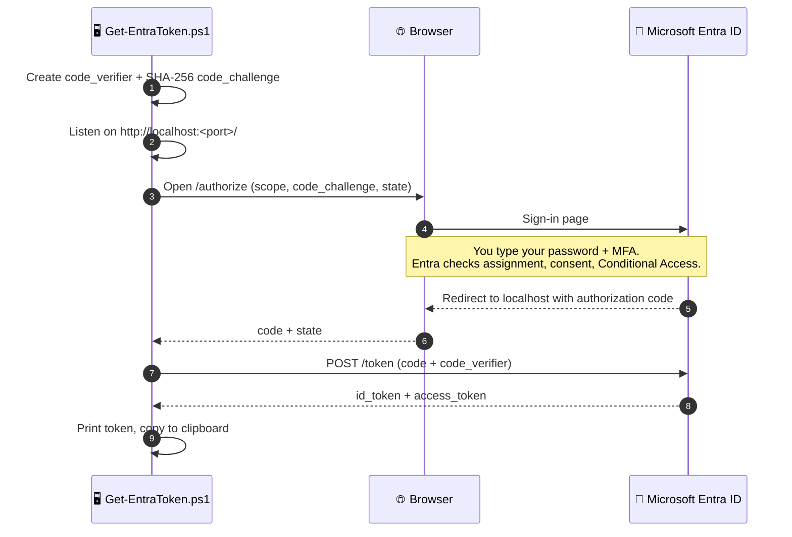

<a id="top"></a>

<div align="center">

# 🔑 Get-EntraToken

**A PowerShell script that signs you in to Microsoft Entra ID with the normal Microsoft sign-in page and gives you a token to inspect in [jwt.ms](https://jwt.ms). Use it to prove an app registration issues the claims you expect before you hand the setup to another team.**

[](https://learn.microsoft.com/powershell/)
[](https://learn.microsoft.com/entra/identity-platform/)
[](https://learn.microsoft.com/entra/identity-platform/v2-oauth2-auth-code-flow)
[](#-one-time-app-setup)
[](https://github.com/21bshwjt/entra-id-claims-and-tokens/stargazers)
[](https://github.com/21bshwjt/entra-id-claims-and-tokens/network/members)

[Quick Start](#quick-start) · [How It Works](#how-it-works) · [What to Check](#what-to-check) · [Use Cases](#use-cases) · [Troubleshooting](#troubleshooting) · [Report a Bug](https://github.com/21bshwjt/entra-id-claims-and-tokens/issues/new)

</div>

---

## 📑 Table of contents

- [💡 Why?](#why)
- [✨ Features](#features)
- [🏗 How it works](#how-it-works)
- [📋 Prerequisites](#prerequisites)
- [🔐 One-time app setup](#setup)
- [🚀 Quick start](#quick-start)
- [⚙ Parameters](#parameters)
- [🔍 What to check in jwt.ms](#what-to-check)
- [🧯 Troubleshooting](#troubleshooting)
- [🛡 Security](#security)
- [📖 Key concepts](#concepts)
- [🧩 10 claim use cases with Entra setup](#use-cases)
- [🧱 Three kinds of app: normal SPN, API app, web app](#app-kinds)
- [🌐 Azure portal sign-in vs your own app](#portal-vs-app)
- [📁 Project structure](#structure)
- [📚 Microsoft references](#references)
- [📝 Changelog](#changelog)

---

<a id="why"></a>

## 💡 Why?

An app team asks: *"Will the token contain `roles`, `department` and the right `aud`?"* The only reliable answer is to sign in as a real test user and read the token. This script does exactly that, with no SDK, no client secret and nothing hard-coded, so you can check an app registration before you hand it to another team (for example ServiceNow).

---

<a id="features"></a>

## ✨ Features

<table>
<tr>
<td width="50%" valign="top">

### 🔐 Real sign-in
- 🌐 The normal Microsoft sign-in page in your browser
- 🔑 **Authorization Code + PKCE**, the flow desktop apps use
- 👮 Works with **MFA** and **Conditional Access**

</td>
<td width="50%" valign="top">

### 🧰 Zero setup
- 🚫 **No client secret**, no SDK, no modules
- 🧾 **Nothing hard-coded**: tenant, client and scope are parameters
- 📋 Token copied to the clipboard, ready for jwt.ms

</td>
</tr>
<tr>
<td width="50%" valign="top">

### 🎯 Any token
- 🪪 **ID token** or **access token** (`-TokenType`)
- 🎚 Any scope: your own API, Microsoft Graph, others (`-Scope`)
- 🔌 Choose the local port (`-Port`)

</td>
<td width="50%" valign="top">

### 📚 Built-in guide
- ✅ Claim-by-claim checklist for jwt.ms
- 🧯 AADSTS error table with fixes
- 🧩 10 real-world claim use cases with Entra steps

</td>
</tr>
</table>

---

<a id="how-it-works"></a>

## 🏗 How it works



| Channel | Carries | Why it's safe |
| --- | --- | --- |
| 🌐 **Front channel** (browser redirects) | The short-lived authorization code | The code is useless without the verifier |
| 🔒 **Back channel** (direct HTTPS call) | The code verifier and the tokens | The verifier never passes through the browser |

**The scope decides which token you get:**

```text
openid   profile   api://<client-id>/api.access
  |         |              |
  |         |              +-- access token for your API (aud = client-id, scp = api.access)
  |         +-- profile claims (name, preferred_username)
  +-- ID token
```

> [!IMPORTANT]
> If you request a Microsoft Graph scope (for example `User.Read`), the access token is **for Graph**. It never contains your app's roles or custom claims, and Microsoft says not to validate or depend on the format of tokens for APIs you don't own.

---

<a id="prerequisites"></a>

## 📋 Prerequisites

| | Requirement |
| --- | --- |
| 🖥 | Windows PowerShell 5.1 or PowerShell 7+ |
| 🌐 | A browser on the same machine |
| 🏢 | An Entra ID app registration you can configure (app owner, Application Administrator or Cloud Application Administrator) |
| 👤 | A test user assigned to the app (**not** a Global Administrator, see [Troubleshooting](#troubleshooting)) |

---

<a id="setup"></a>

## 🔐 One-time app setup

All steps are in the **[Microsoft Entra admin center](https://entra.microsoft.com)**.

<details open>
<summary><b>Step 1 · Allow the localhost redirect (required)</b></summary>
<br/>

**App registrations → (your app) → Authentication → Add a platform → Mobile and desktop applications**

- Custom redirect URI: `http://localhost` → **Configure**

No client secret and no "Allow public client flows" setting are needed.

> [!TIP]
> Entra ID ignores the port when it matches a `localhost` redirect URI, so one `http://localhost` entry works with any `-Port`. Don't register several localhost URIs that differ only by port.

</details>

<details open>
<summary><b>Step 2 · Get an access token for your own API</b></summary>
<br/>

1. **Expose an API → Application ID URI → Add** → accept `api://<client-id>` → **Save**
2. **Add a scope** → name `api.access`, Admins only, Enabled → **Add scope**
3. **Manifest** → in the `api` section set `"requestedAccessTokenVersion": 2` → **Save**
4. **API permissions → Add a permission → APIs my organization uses → (your app) → Delegated → `api.access`** → **Grant admin consent**

> [!NOTE]
> `requestedAccessTokenVersion` is set by the **API** (resource), not the client. If it's `null`, Entra ID issues v1.0 access tokens.

</details>

<details>
<summary><b>Step 3 · Optional extras to see in the token</b></summary>
<br/>

| To see | Configure |
| --- | --- |
| `roles` | **App roles → Create app role** (Users/Groups), then **Enterprise apps → (app) → Users and groups** → assign the user to the role |
| Custom claims (e.g. `department`, `empid`) | **Enterprise apps → (app) → Single sign-on → Attributes & Claims → Add new claim**, and set `"acceptMappedClaims": true` in the `api` section of the Manifest |
| `groups` / `wids` | **Token configuration → Add groups claim** |
| `upn` in a v2 access token | **Token configuration → Add optional claim → Access → upn** |
| `amr` in a v2 token | **Token configuration → Add optional claim → ID / Access → amr** |

</details>

---

<a id="quick-start"></a>

## 🚀 Quick start

```powershell
# 1⃣  Access token for your own API (default scope: openid profile api://<ClientId>/api.access)
.\Scripts\Get-EntraToken.ps1 -TenantId <tenant-id> -ClientId <client-id>

# 2⃣  ID token
.\Scripts\Get-EntraToken.ps1 -TenantId <tenant-id> -ClientId <client-id> -TokenType Id

# 3⃣  Any other scope, e.g. a Microsoft Graph token
.\Scripts\Get-EntraToken.ps1 -TenantId <tenant-id> -ClientId <client-id> -Scope "User.Read"

# 4⃣  Use a different local port
.\Scripts\Get-EntraToken.ps1 -TenantId <tenant-id> -ClientId <client-id> -Port 8500
```

> [!TIP]
> If PowerShell blocks the script, allow it for the current window only:
> ```powershell
> Set-ExecutionPolicy -Scope Process -ExecutionPolicy Bypass
> ```

**Then:**

1. 🌐 Your browser opens the Microsoft sign-in page. Sign in as the test user.
2. ✅ The browser shows "Signed in. You can close this tab."
3. 📋 PowerShell prints the token and copies it to the clipboard.
4. 🔍 Open [jwt.ms](https://jwt.ms), paste the token and read the **Claims** tab. 🎉

---

<a id="parameters"></a>

## ⚙ Parameters

| Parameter | Required | Default | Description |
| --- | :---: | --- | --- |
| `-TenantId` | ✅ | | Directory (tenant) ID: **Entra ID → Overview → Tenant ID** |
| `-ClientId` | ✅ | | Application (client) ID: **App registrations → (app) → Overview** |
| `-Scope` | | `openid profile api://<ClientId>/api.access` | Scopes to request. Decides the access token's `aud` |
| `-TokenType` | | `Access` | `Access` or `Id`: which token to print and copy |
| `-Port` | | `8400` | Local port that receives the sign-in response |

---

<a id="what-to-check"></a>

## 🔍 What to check in jwt.ms

> [!IMPORTANT]
> Check **`aud` first**. If it isn't the app you expect, nothing else in the token matters.

| Claim | Expected (access token for your API) | If wrong |
| --- | --- | --- |
| `aud` | Your client ID (always the API's client ID in v2.0 tokens) | Wrong scope requested (e.g. a Graph scope) |
| `scp` | `api.access` | Scope not created, or not requested |
| `ver` | `2.0` | Set `requestedAccessTokenVersion` to `2` |
| `iss` | `https://login.microsoftonline.com/<tenant-id>/v2.0` | Same: the token is v1.0 |
| `azp` | The client app's ID | Replaces `appid` in v2.0 tokens |
| `azpacr` | `0` (public client) | `1` = client secret, `2` = certificate |
| `oid` | The user's Object ID | Always present for a user |
| `roles` | Your app role value | User not assigned to the role |
| Custom claims | Your configured values | Attribute empty on the user, or `acceptMappedClaims` not set |

**ID token vs access token:** if the client and the API are the same app, both tokens carry the same roles and custom claims. Only the **access token** has `scp`, and only the access token is sent to an API.

**Claims you can ignore:** `aio`, `rh` and `xms_*` are internal. `uti` is the token's unique ID, Entra's equivalent of the standard `jti` claim. `sid` is the session ID.

---

<a id="troubleshooting"></a>

## 🧯 Troubleshooting

| Error or symptom | Cause | Fix |
| --- | --- | --- |
| `AADSTS50011` | Redirect URI mismatch | Add `http://localhost` under **Mobile and desktop applications** |
| `AADSTS9002327` | Redirect URI is under **Single-page application** (SPA redirects need a browser `Origin` header) | Move it to **Mobile and desktop applications** |
| `AADSTS65001` | No consent | Grant admin consent for the scope |
| `AADSTS50105` | User not assigned and **Assignment required = Yes** | **Enterprise apps → (app) → Users and groups** → add the user |
| `AADSTS500011` | Resource principal not found: scope or Application ID URI missing, or wrong tenant | Complete **Expose an API**; check `-TenantId` |
| `AADSTS50146` | Custom claims without a signing key or `acceptMappedClaims` | Set `"acceptMappedClaims": true` in the Manifest's `api` section |
| `AADSTS501461` | `acceptMappedClaims` with a token audience that isn't the app GUID or a verified domain | Use v2 tokens (aud = client ID) or a verified-domain Application ID URI |
| `AADSTS700016` | App not found in tenant | Check `-TenantId` and `-ClientId` |
| "Could not listen on ..." | Port in use | Use `-Port 8500` |
| `aud` is Graph | A Graph scope was requested | Use `api://<client-id>/api.access` |
| `roles` missing | User has **Default Access** only (it never adds `roles`) | Assign the user to a named app role |
| Custom claim missing | Attribute empty, or typo in claim name | Fill in the user's attribute; check spelling (case-sensitive) |

> [!WARNING]
> **Don't test with a Global Administrator.** The "Assignment required" check doesn't apply to Global Administrators, so they can sign in without an assignment and hide an `AADSTS50105` problem your real users will hit.

---

<a id="security"></a>

## 🛡 Security

> [!CAUTION]
> Tokens are **bearer tokens**: anyone holding one can use it until it expires. The default access token lifetime is a random value between **60 and 90 minutes** (75 on average), and with Continuous Access Evaluation it can be much longer. Don't share, log or commit tokens.

- 📋 The clipboard keeps the token until you copy something else. Clear it after testing.
- 🧹 Remove the `http://localhost` redirect URI from the app when you no longer need it.
- 🔑 The script never handles your password: you type it on Microsoft's page.
- 🧾 The script requests only the scopes you pass, and checks the `state` value to reject forged responses.
- 🚫 Never commit real tenant IDs, client IDs or tokens to a public repository.

---

<a id="concepts"></a>

## 📖 Key concepts

| Term | Meaning |
| --- | --- |
| OAuth 2.0 | Protocol for permission to call APIs (access tokens) |
| OpenID Connect (OIDC) | Adds identity on top of OAuth (ID tokens); switched on by the `openid` scope |
| ID token | Who signed in; stays in the client app |
| Access token | Permission to call one API; sent as `Authorization: Bearer <token>` |
| Scope | What you ask for; decides the access token's `aud` |
| PKCE | Proof that the party exchanging the code is the one that started the sign-in |
| Front channel | Browser redirects (carries the authorization code) |
| Back channel | Direct app-to-Entra call (carries the tokens) |
| Service principal | The app's identity in your tenant; supplies the rules (assignment, roles, claims) |
| `oid` | The user's permanent Object ID; best for matching users in other systems |

---

<a id="use-cases"></a>

## 🧩 10 claim use cases with Entra setup

Every use case follows the same pattern: configure Entra ID, a user (or program) signs in, Entra ID puts a claim in the token, and the app reads that claim. Test each one with this script and jwt.ms.

| # | Need | Key claim | Where you configure it |
| :---: | --- | --- | --- |
| 1 | 🔘 Buttons or features by role | `roles` | App roles + Users and groups |
| 2 | 👑 Entra admin-only pages | `wids` | Token configuration → groups claim (Directory roles) |
| 3 | 👥 Data by team | `groups` | Token configuration → groups claim |
| 4 | 🪪 Show or route by user details | Custom (`department`, `empid`) | Attributes & Claims + `acceptMappedClaims` |
| 5 | 🤖 Program with no user | `roles` (app-only) | App role for Applications + certificate |
| 6 | 📅 Show Microsoft 365 data | Graph token (`scp`) | API permissions → Microsoft Graph |
| 7 | 🔁 API calls another API as the user | New token, new `aud` | Expose an API + downstream permission + certificate |
| 8 | 🏷 SaaS sign-in with vendor roles | SAML NameID + role | SAML SSO + app roles with vendor values |
| 9 | 🔐 MFA for sensitive actions | `acrs` / `amr` | Conditional Access authentication context |
| 10 | 🧳 Guests vs employees | `acct` | Optional claim |

<details>
<summary><b>1 · Show buttons only to the right people (<code>roles</code>)</b></summary>
<br/>

**Story:** In an Expense app, everyone can submit expenses, but only managers see the **Approve** button.

**Flow:**

1. A manager signs in to the Expense app.
2. Entra ID checks whether the user (or their group) is assigned the `Expense.Approver` role.
3. Entra ID adds `"roles": ["Expense.Approver"]` to the token.
4. The app shows the Approve button only when that role is present.

**Entra setup:**

1. **App registrations → Expense app → App roles → Create app role**
   - Display name: `Expense Approver` · Allowed member types: **Users/Groups** · Value: `Expense.Approver` · Enable → **Apply**
2. **Enterprise apps → Expense app → Users and groups → Add user/group** → select the **Managers** group → role **Expense Approver** → **Assign**
3. (Optional) **Enterprise apps → Expense app → Properties → Assignment required = Yes**

**Token:**

```json
"roles": ["Expense.Approver"]
```

> [!NOTE]
> The app checks the role's **Value**, not its display name, and it's case-sensitive. Group-based assignment needs **Entra ID P1 or P2**, and nested group memberships aren't supported: users must be direct members of the assigned group.

</details>

<details>
<summary><b>2 · Admin-only pages for IT staff (<code>wids</code>)</b></summary>
<br/>

**Story:** An IT Tools portal has a "Reset user MFA" page that only Helpdesk or Global Administrators may open.

**Flow:**

1. An IT admin signs in.
2. Entra ID looks up the user's Entra admin roles.
3. Entra ID adds the role template IDs to `wids`.
4. The app shows the admin page if `wids` contains the Helpdesk or Global Administrator ID.

**Entra setup:**

1. **App registrations → IT Tools → Token configuration → Add groups claim** → tick **Directory roles** → **Add**
   (Manifest: `"groupMembershipClaims": "DirectoryRole"` or `"All"`)
2. Confirm the admins hold the role: **Entra ID → Roles & admins → Helpdesk Administrator → Assignments**

**Token:**

```json
"wids": ["729827e3-9c14-49f7-bb1b-9608f156bbb8", "b79fbf4d-3ef9-4689-8143-76b194e85509"]
```

| GUID | Meaning |
| --- | --- |
| `62e90394-69f5-4237-9190-012177145e10` | Global Administrator |
| `729827e3-9c14-49f7-bb1b-9608f156bbb8` | Helpdesk Administrator |
| `b79fbf4d-3ef9-4689-8143-76b194e85509` | Sent for every non-guest user; not an admin role |

> [!NOTE]
> These are role **template IDs**, the same in every tenant (full list: [Microsoft Entra built-in roles](https://learn.microsoft.com/entra/identity/role-based-access-control/permissions-reference#all-roles)). With PIM, the role appears only while it's active. `wids` = Entra admin roles; `roles` = roles you created for this app.

</details>

<details>
<summary><b>3 · Show data by team (<code>groups</code>)</b></summary>
<br/>

**Story:** In a Reports dashboard, Finance sees finance reports and HR sees HR reports.

**Flow:**

1. A Finance employee signs in.
2. Entra ID finds the user's groups that are assigned to the app.
3. Entra ID adds their Object IDs to `groups`.
4. The app matches the Finance group ID and shows finance reports.

**Entra setup:**

1. **App registrations → Reports → Token configuration → Add groups claim** → **Groups assigned to the application** → **Add**
2. **Enterprise apps → Reports → Users and groups → Add user/group** → add the Finance and HR groups
3. Note each group's **Object ID** (**Entra ID → Groups → (group) → Overview**) and give them to the app team

**Token:**

```json
"groups": ["a1b2c3d4-0000-1111-2222-333344445555"]
```

> [!WARNING]
> Values are GUIDs, not names. If a user is in more than **200 groups** (JWT) or **150** (SAML), Entra ID drops the `groups` claim and adds an **overage** claim pointing to Microsoft Graph. "Groups assigned to the application" avoids this and doesn't include nested groups. Prefer app roles (use case 1) where possible.

</details>

<details>
<summary><b>4 · Personalise with user details (custom claims)</b></summary>
<br/>

**Story:** An HR portal shows "Welcome, IT department, Employee #123" and routes tickets by department.

**Flow:**

1. The user signs in.
2. Entra ID reads Department and Employee ID from the user's profile.
3. Entra ID adds them as `department` and `empid`.
4. The app displays them and routes by `department`.

**Entra setup:**

1. **Enterprise apps → HR portal → Single sign-on → Attributes & Claims → Edit → Add new claim**
   - `department` → Source attribute `user.department` → **Save**
   - `empid` → Source attribute `user.employeeid` → **Save**
2. **App registrations → HR portal → Manifest** → in the `api` section set `"acceptMappedClaims": true` → **Save**
3. Fill in each user's details: **Entra ID → Users → (user) → Properties → Edit**

**Token:**

```json
"department": "IT",
"empid": "123"
```

> [!CAUTION]
> Set `acceptMappedClaims` **only for single-tenant apps**. Multi-tenant apps must use a custom signing key instead, because the setting could let others create claims-mapping policies for your app.

**Watch-outs:** `AADSTS50146` means `acceptMappedClaims` (or a signing key) is missing. An empty attribute means no claim. Claim names are case-sensitive. Names in the restricted claim set (for example `aud`, `sub`, `upn`, `roles`, `scp`, `tid` and anything starting with `xms_`) can't be used. Use custom claims for display and routing, not permissions.

</details>

<details>
<summary><b>5 · Background job with no user (client credentials)</b></summary>
<br/>

**Story:** Every night a sync job copies new employees into ServiceNow. Nobody is signed in.

**Flow:**

1. The job sends its client ID plus certificate (or secret) to Entra ID.
2. Entra ID checks the job's app has the `ServiceNow.Integration` application permission.
3. Entra ID returns an access token with `roles` and no user.
4. The job calls ServiceNow with `Authorization: Bearer <token>`.

**Entra setup:**

1. **App registrations → ServiceNow-Integration → App roles → Create app role**
   - Display name: `ServiceNow Integration` · Allowed member types: **Applications** · Value: `ServiceNow.Integration` → **Apply**
2. **API permissions → Add a permission → APIs my organization uses → ServiceNow-Integration → Application permissions** → tick the role → **Add permissions**
3. **Grant admin consent**
4. **Certificates & secrets** → upload a certificate (recommended) or create a client secret with an expiry date

**Token request:**

```powershell
Invoke-RestMethod -Method Post -Uri "https://login.microsoftonline.com/<tenant-id>/oauth2/v2.0/token" -Body @{
  grant_type    = "client_credentials"
  client_id     = "<client-id>"
  client_secret = "<secret>"   # test only; use a certificate in production
  scope         = "api://<client-id>/.default"
}
```

**Token:**

```json
"aud": "<client-id>",
"roles": ["ServiceNow.Integration"]
```

> [!IMPORTANT]
> The scope **must** be `{resource}/.default`; you can't request individual application permissions. Every app role granted for that API is included. No user means no ID token and no `name`/`upn`.

**Watch-outs:** protect the certificate or secret (Key Vault, rotation). In ServiceNow use **Integration as a Service** with a Web Service Access Only account.

</details>

<details>
<summary><b>6 · Show the user's Microsoft 365 data (Graph)</b></summary>
<br/>

**Story:** An intranet homepage shows the user's photo and today's meetings.

**Flow:**

1. The user signs in.
2. The app requests Graph scopes (`User.Read Calendars.Read`).
3. Entra ID returns an access token for Microsoft Graph.
4. The app calls `https://graph.microsoft.com/v1.0/me/events` with the token.

**Entra setup:**

1. **App registrations → Intranet → API permissions → Add a permission → Microsoft Graph → Delegated** → `User.Read`, `Calendars.Read` → **Add**
2. **Grant admin consent** (or allow user consent)
3. **Authentication** → add the app's redirect URI under the right platform

**Token (typical):**

```json
"aud": "00000003-0000-0000-c000-000000000000",
"scp": "Calendars.Read User.Read"
```

**Test with this script:** `.\Scripts\Get-EntraToken.ps1 -TenantId <t> -ClientId <c> -Scope "User.Read Calendars.Read"`

> [!NOTE]
> Graph tokens are for Graph to validate, not your app, and they don't follow your app's `requestedAccessTokenVersion`. Reading one in jwt.ms is fine for debugging, but don't build code that depends on its contents. A Graph token never contains your app's roles or custom claims. Request only the permissions you need.

</details>

<details>
<summary><b>7 · Your API calls another API as the user (On-Behalf-Of)</b></summary>
<br/>

**Story:** A web front end calls your Company API, which then calls ServiceNow as the same user.

**Flow:**

1. The front end gets a token for the Company API and calls it.
2. The Company API sends that token to Entra ID and asks for a ServiceNow token on behalf of the user.
3. Entra ID returns a new token: `aud` = ServiceNow-Integration, same user.
4. The Company API calls ServiceNow with the new token.

**Entra setup:**

1. **App registrations → Company API → Expose an API** → Application ID URI → scope `access`
2. **Company API → Certificates & secrets** → certificate or secret
3. **Company API → API permissions → ServiceNow-Integration → Delegated → `api.access`** → **Grant admin consent**
4. **Front-end app → API permissions → Company API → Delegated → `access`** → **Grant admin consent**

**Token exchange (Company API):**

```text
grant_type          = urn:ietf:params:oauth:grant-type:jwt-bearer
requested_token_use = on_behalf_of
assertion           = <access token the Company API received>
scope               = api://<servicenow-client-id>/api.access
client_id + certificate or secret = the Company API's own
```

> [!WARNING]
> The `assertion` must be an **access token** whose `aud` is the Company API itself, not an ID token and not a token meant for another API. Never forward the original token downstream.

**Watch-outs:** MSAL / Microsoft.Identity.Web handle the exchange (`AcquireTokenOnBehalfOf`). `AADSTS65001` means consent is missing.

</details>

<details>
<summary><b>8 · SaaS sign-in where the vendor decides the roles (SAML)</b></summary>
<br/>

**Story:** Staff sign in to AWS; developers get the Developer role and admins the Admin role, using AWS's role names.

**Flow:**

1. The user opens AWS (or the My Apps tile).
2. AWS sends the user to Entra ID.
3. Entra ID builds a SAML response with the NameID and the assigned role value.
4. The browser posts it to AWS, which signs the user in with that role.

**Entra setup:**

1. **Enterprise apps → New application** → pick the app from the gallery → **Create**
2. **Single sign-on → SAML → Basic SAML Configuration** → vendor's Identifier (Entity ID) and Reply URL → **Save**
3. **Attributes & Claims** → check **Unique User Identifier (Name ID)** and the role claim (`user.assignedroles`)
4. Create app roles with the **exact values the vendor requires** (for AWS, role ARNs; AWS can import them through **Provisioning**)
5. **Users and groups** → assign groups to roles
6. **SAML Certificates → Federation Metadata XML → Download** → give it to the vendor

**Watch-outs:** test with **Test single sign-on** or a SAML-tracer browser extension. Role values must match the vendor exactly. NameID exists only for SAML apps; OIDC apps use `sub`, which can't be customised, so use `oid` or a custom claim instead.

</details>

<details>
<summary><b>9 · Require MFA before a sensitive action (<code>acrs</code> / <code>amr</code>)</b></summary>
<br/>

**Story:** In a Payroll app, viewing payslips needs a normal sign-in, but changing bank details must require MFA.

**Flow:**

1. The user signs in normally.
2. The user clicks **Change bank details**.
3. The app asks Entra ID for a token satisfying authentication context `c1`.
4. The Conditional Access policy for `c1` requires MFA; the user completes it.
5. Entra ID returns a token with `"acrs": ["c1"]`, and the app allows the change.

**Entra setup:**

1. **Entra ID → Conditional Access → Authentication contexts → New authentication context** → Name `Sensitive action`, ID `c1` (IDs `c1` to `c99` are available), tick **Publish to apps** → **Save**
2. **Conditional Access → Policies → New policy** → Users: payroll users · Target resources: **Authentication context** → `Sensitive action` · Grant: **Require multifactor authentication** · **Report-only** first, then **On**
3. App code: request the token with the claims parameter `{"access_token":{"acrs":{"essential":true,"value":"c1"}}}` (MSAL supports this)
4. (Optional) API app → **Token configuration → Add optional claim → Access → `acrs`**, so Entra ID can add already-satisfied contexts without an extra round trip

**Simpler alternative:** check that the `amr` claim contains `mfa` (the rule lives in code instead of Conditional Access). For v2.0 tokens, add `amr` as an optional claim first.

**Token:**

```json
"acrs": ["c1"],
"amr": ["pwd", "mfa"]
```

> [!NOTE]
> Conditional Access needs **Entra ID P1**. Authentication context works only for apps that sign in users, not app-only tokens. It lets admins tighten rules later without code changes.

</details>

<details>
<summary><b>10 · Treat guests differently from employees (<code>acct</code>)</b></summary>
<br/>

**Story:** Partner staff are guests. In a Project portal, employees see all projects; guests see only their own.

**Flow:**

1. A guest signs in.
2. Entra ID knows the user is a guest.
3. Entra ID adds `"acct": 1` (members get `0`).
4. The app limits the view for guests.

**Entra setup:**

1. **App registrations → Project portal → Token configuration → Add optional claim** → token type **ID** (and **Access** if needed) → tick `acct` → **Add**
2. Invite partners if needed: **Entra ID → Users → New user → Invite external user**
3. (Optional) assign only the needed guests, with **Assignment required = Yes**

**Token:**

```json
"acct": 1
```

**Watch-outs:** a guest's `oid` exists only in your tenant. Guest UPNs look like `name_partner.com#EXT#@yourtenant.onmicrosoft.com`, so identify guests by `oid`, not by UPN or email.

</details>

---

<a id="app-kinds"></a>

## 🧱 Three kinds of app: normal SPN, API app, web app

| | 🤖 Normal SPN | 🔌 API app (`api.access`) | 🌐 Web app (`localhost:3000`) |
| --- | --- | --- | --- |
| Role | Program that logs in as itself | The API that tokens are made for | The website a person uses |
| Who signs in | The program (secret or certificate) | Nobody; it receives tokens | A user (password + MFA) |
| Asks Entra for | A token for Azure or Graph | Nothing; it defines the scope | A token for `api.access` plus an ID token |
| Does with the token | Calls Azure or Graph | Checks `aud`, `scp`, `roles` | Sends it to the API as a bearer token |
| Key Entra settings | Secret/certificate; Azure RBAC or Graph permissions | Expose an API, scope, v2 tokens, app roles | Redirect URI, API permission for `api.access` |
| Example | GitHub Actions deploying to Azure | ServiceNow-Integration | React/Node site with a "Create ticket" button |

<details>
<summary><b>Web app and API app together</b></summary>
<br/>

1. The user opens `http://localhost:3000`.
2. The web app sends the user to Microsoft sign-in with `openid profile api://<api-app-id>/api.access`.
3. Entra ID returns an ID token (for the web app) and an access token (`aud` = API app).
4. The web app greets the user from the ID token and calls the API with the access token.
5. The API checks `aud`, `scp` and `roles`.

**Setting up the web app as its own registration:**

1. **App registrations → New registration** → `My-Web-App`, single tenant
2. **Authentication → Add a platform**: **Single-page application** (React/Angular/Vue) → `http://localhost:3000`, or **Web** (Node/.NET/Java) → callback URL + client secret or certificate
3. **API permissions → APIs my organization uses → (API app) → Delegated → `api.access`** → **Grant admin consent**
4. In code: `clientId` = My-Web-App's ID, `scopes` = `["api://<api-app-id>/api.access"]`

The access token's `aud` stays the API app; `azp` shows My-Web-App, so the API can tell which client called.

</details>

> [!NOTE]
> **User sign-in vs service principal credentials:** during a user sign-in, the token comes from the user's credentials. The service principal only supplies the rules (assignment, consent, roles, custom claims, Conditional Access). Its own certificate or secret is used only when no user is involved (use case 5).

---

<a id="portal-vs-app"></a>

## 🌐 Azure portal sign-in vs your own app

| | Azure portal | Your app |
| --- | --- | --- |
| Sign-in page and protocol | `login.microsoftonline.com`, OIDC + OAuth | Same |
| Credentials, MFA, Conditional Access | Your own | Same |
| App registration | Microsoft's; you can't change it | Yours |
| Access token `aud` | Azure Resource Manager or Graph | Your app ID |
| Your app roles and custom claims | Not included | Included |
| Permissions decided by | Azure RBAC and Entra admin roles (`wids`) | Your app roles and the target system |

Both share one Entra session, so the second sign-in may not ask for a password, but each app still gets its own token addressed to it.

---

<a id="structure"></a>

## 📁 Project structure

```text
📦 entra-id-claims-and-tokens
 ┣ 📂 Scripts
 ┃ ┗ 📜 Get-EntraToken.ps1   # Browser sign-in (Auth Code + PKCE), prints and copies the token
 ┗ 📜 README.md              # This guide
```

---

<a id="references"></a>

## 📚 Microsoft references

The technical details in this guide were checked against Microsoft Learn:

| Topic | Microsoft Learn page |
| --- | --- |
| Authorization code flow + PKCE | [OAuth 2.0 authorization code flow](https://learn.microsoft.com/entra/identity-platform/v2-oauth2-auth-code-flow) |
| Localhost redirect URIs and ports | [Redirect URI restrictions](https://learn.microsoft.com/entra/identity-platform/reply-url) |
| Access token claims (`aud`, `azp`, `azpacr`, `uti`, `wids`, `groups`) | [Access token claims reference](https://learn.microsoft.com/entra/identity-platform/access-token-claims-reference) |
| Token lifetime, token validation | [Access tokens](https://learn.microsoft.com/entra/identity-platform/access-tokens) |
| Optional claims (`acct`, `acrs`, `amr`, `upn`) | [Optional claims reference](https://learn.microsoft.com/entra/identity-platform/optional-claims-reference) |
| Custom claims, `acceptMappedClaims` | [Customize JWT claims](https://learn.microsoft.com/entra/identity-platform/jwt-claims-customization) |
| Restricted claim set | [Claims customization reference](https://learn.microsoft.com/entra/identity-platform/reference-claims-customization) |
| Manifest `api` section | [App manifest (Microsoft Graph format)](https://learn.microsoft.com/entra/identity-platform/reference-microsoft-graph-app-manifest) |
| Group assignment (P1/P2, no nesting) | [Assign users and groups to an app](https://learn.microsoft.com/entra/identity/enterprise-apps/assign-user-or-group-access-portal) |
| Groups overage (200 JWT / 150 SAML) | [Configure group claims](https://learn.microsoft.com/entra/identity/hybrid/connect/how-to-connect-fed-group-claims) |
| Role template IDs | [Microsoft Entra built-in roles](https://learn.microsoft.com/entra/identity/role-based-access-control/permissions-reference) |
| Client credentials and `/.default` | [Client credentials flow](https://learn.microsoft.com/entra/identity-platform/v2-oauth2-client-creds-grant-flow) |
| On-Behalf-Of | [On-Behalf-Of flow](https://learn.microsoft.com/entra/identity-platform/v2-oauth2-on-behalf-of-flow) |
| Authentication context (`acrs`) | [Developer guide to authentication context](https://learn.microsoft.com/entra/identity-platform/developer-guide-conditional-access-authentication-context) |
| AADSTS errors | [Error codes reference](https://learn.microsoft.com/entra/identity-platform/reference-error-codes) · [AADSTS50105](https://learn.microsoft.com/troubleshoot/entra/entra-id/app-integration/error-code-aadsts50105-user-not-assigned-role) |

---

<a id="changelog"></a>

## 📝 Changelog

| Version | Date | Change |
| --- | --- | --- |
| 1.0 | 2026-11-22 | First version: browser sign-in (Authorization Code + PKCE), `-TokenType Access/Id`, `-Scope`, `-Port`, copy to clipboard |
| 1.1 | 2026-11-22 | Added 10 claim use cases with Entra setup, the three kinds of app, and portal vs own app |
| 1.2 | 2026-11-22 | Moved the script to `Scripts/`; new README layout; facts checked against Microsoft Learn |

<details>
<summary><b>💭 Ideas for later versions</b></summary>
<br/>

- [ ] Decode the token in PowerShell and show key claims with OK/FAIL checks
- [ ] Optional `-ExpectedClaims` parameter to verify specific claims automatically
- [ ] Client credentials mode (`-ClientSecret` / `-CertificateThumbprint`) for app-only tokens
- [ ] Timeout if the browser never returns
- [ ] Clear the clipboard after a set time

</details>

---

<div align="center">

**Built with ❤ using PowerShell and Microsoft Entra ID**

⭐ If this saved you a support ticket, give the repo a star!

[⬆ Back to top](#top)

</div>
